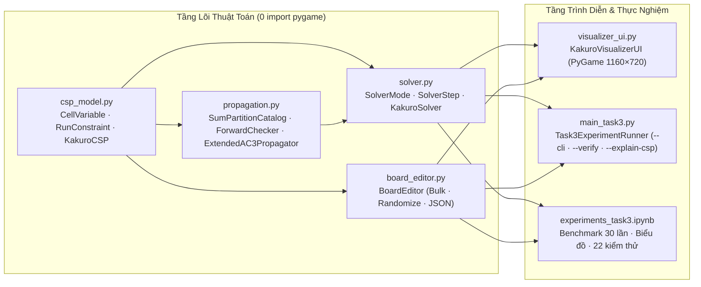

# TỔNG HỢP HOÀN THIỆN NHIỆM VỤ 3 — CÂU ĐỐ KAKURO (BÀI TOÁN THỎA MÃN RÀNG BUỘC — CSP)

> Tài liệu tổng hợp toàn bộ cơ sở lý thuyết Bài toán Thỏa mãn Ràng buộc $\langle X, D, C \rangle$, kiến trúc Lập trình hướng đối tượng (OOP), các kỹ thuật tiền xử lý tổ hợp tổng (*Sum Partitions*), lan truyền ràng buộc (*Forward Checking* & *Extended AC-3*), bộ ba heuristic (*MRV*, *Degree*, *LCV*), giao diện **PyGame tối giản & Trình soạn thảo bảng (`BoardEditor`)** và kết quả thực nghiệm cho **Nhiệm vụ 3 (3.0 điểm)** — Học phần **503043: Nhập môn Trí tuệ Nhân tạo** (Đại học Tôn Đức Thắng).

---

## 1. Đối Chiếu Mức Độ Hoàn Thành Theo Đề Bài & Quy Ước Thiết Kế

| Hạng mục yêu cầu | Tiêu chuẩn tham chiếu | Mức độ hoàn thành & sản phẩm bàn giao |
| :--- | :--- | :--- |
| **Yêu cầu 3.1 (1.0đ):** Mô hình hóa Kakuro thành CSP $\langle X, D, C \rangle$, bất biến tổng & phân tích lan truyền ràng buộc | [DEBAI.md](file:///d:/3.1.%20AI/Final/DEBAI.md) (II.c.1) | **100%** — Hình thức hóa đầy đủ biến $X_{(r,c)}$, miền $D(X_{(r,c)}) = \{1..9\}$ (hoặc đơn trị với số cho trước), ràng buộc tổ hợp `AllDiff + Sum` theo từng dãy ngang/dọc trong [csp_model.py](file:///d:/3.1.%20AI/Final/source/task3/csp_model.py); chứng minh & kiểm chứng bất biến $\sum \text{Across} = \sum \text{Down}$ trên 4/4 bảng mẫu; hỗ trợ giải thích trực tiếp qua `--explain-csp`. |
| **Yêu cầu 3.2 (1.5đ):** Cài đặt thuật toán giải kết hợp Quay lui, Lan truyền ràng buộc & Heuristic; đánh giá thực nghiệm trên bảng mẫu `5×5` và bảng phức tạp `9×9` | [DEBAI.md](file:///d:/3.1.%20AI/Final/DEBAI.md) (II.c.2) | **100%** — Cài đặt 3 cấu hình đối sánh (`Quay lui cơ bản`, `Kiểm tra tiến + MRV`, `AC-3 mở rộng + MRV/Bậc/LCV`) trong [propagation.py](file:///d:/3.1.%20AI/Final/source/task3/propagation.py) và [solver.py](file:///d:/3.1.%20AI/Final/source/task3/solver.py). Thực nghiệm lặp **30 lần + warm-up** trên 4 bảng (`5×5`, `6×6`, `8×8`, `9×9`), đạt **100%** nghiệm hợp lệ, **`0` quay lui** với `AC-3 mở rộng` trên cả 4/4 bảng (giảm **827,8×** nút trên `5×5` và **190,4×** nút trên `9×9`), kèm biểu đồ [task3_csp_benchmark.png](file:///d:/3.1.%20AI/Final/report/figures/task3_csp_benchmark.png). |
| **Yêu cầu 3.3 (0.5đ):** Trực quan hóa quá trình giải (miền giá trị, cắt tỉa ràng buộc, quay lui) & trình soạn thảo bảng trên **PyGame** | [DEBAI.md](file:///d:/3.1.%20AI/Final/DEBAI.md) (II.c.3) & [UI.md](file:///d:/3.1.%20AI/Final/UI.md) | **100%** — Giao diện PyGame tối giản `1160 × 720` đúng 3 tông màu chuẩn `UI.md` ([visualizer_ui.py](file:///d:/3.1.%20AI/Final/source/task3/visualizer_ui.py)), hiển thị lưới ứng viên `3×3`, gạch chéo đỏ ứng viên bị loại, nền/viền đỏ nhạt khi quay lui, chữ số xanh ngọc khi gán hợp lệ, hỗ trợ luồng nền có thể hủy hợp tác và trọn bộ Trình soạn thảo (`BoardEditor`, `Bulk Edit`, sinh gợi ý ngẫu nhiên, lưu/mở JSON). |
| **Nguyên lý OOP, macOS 13.7.8 & quy ước ngôn ngữ** | [DEBAI.md](file:///d:/3.1.%20AI/Final/DEBAI.md) & Quy ước dự án | **100%** — Tách rời tuyệt đối Model–View (`0` lệnh `import pygame` trong 5 module lõi); không dùng API riêng của Windows hay `smoothscale`; tiếng Việt có dấu trên PyGame UI, Matplotlib, Notebook & `TASK3.md`; tiếng Việt không dấu (ASCII thuần) trên CLI (`0` dòng ngoài ASCII) và toàn bộ comment/docstring (`0` lỗi kiểm toán); giữ nguyên 100% outputs trong [experiments_task3.ipynb](file:///d:/3.1.%20AI/Final/source/task3/experiments_task3.ipynb). |

---

## 2. Kiến Trúc OOP & Tổ Chức Mã Nguồn (`source/task3/`)

Toàn bộ Nhiệm vụ 3 được thiết kế độc lập theo mô hình 4 tầng rõ ràng (Mô hình CSP – Lan truyền & Bộ giải – Soạn thảo – Giao diện & CLI):



| Tệp / Thư mục | Tầng kiến trúc | Vai trò & Lớp OOP chính |
| :--- | :--- | :--- |
| [__init__.py](file:///d:/3.1.%20AI/Final/source/task3/__init__.py) | Gói Task 3 | Xuất giao diện lập trình thống nhất (`KakuroCSP`, `KakuroSolver`, `BoardEditor`, `SumPartitionCatalog`, `ExtendedAC3Propagator`, `SearchCancelled`, `to_ascii_label`). |
| [csp_model.py](file:///d:/3.1.%20AI/Final/source/task3/csp_model.py) | Mô hình CSP | `CellVariable`, `RunConstraint`, `KakuroCSP`: nạp lưới JSON, kiểm tra tính hợp lệ cấu trúc, bất biến `sum_invariants()`, kiểm tra bộ phận `is_consistent()`, kiểm chứng độc lập `verify_solution()` và xuất lưới ASCII `render_solution_ascii()`. |
| [propagation.py](file:///d:/3.1.%20AI/Final/source/task3/propagation.py) | Lan truyền ràng buộc | `SumPartitionCatalog` (tiền tính toàn bộ $511$ tập con khác rỗng của $\{1..9\}$ theo khóa `(độ dài k, tổng S)`), `ForwardChecker` (cắt tỉa 1 bước AllDiff + cận tổng min/max) và `ExtendedAC3Propagator` (nhất quán cung tổng quát GAC dựa trên tổ hợp phần dư chặt). |
| [solver.py](file:///d:/3.1.%20AI/Final/source/task3/solver.py) | Bộ giải CSP | `SolverMode`, `SolverStep`, `KakuroSolveResult`, `SearchCancelled`, `KakuroSolver`: hỗ trợ 3 chế độ giải, `solve()`, generator `iter_steps()`, cắt tỉa lịch sử có bảo toàn bước cuối `SOLVED`, giới hạn `node_limit` và hủy hợp tác qua `cancel_event`. |
| [board_editor.py](file:///d:/3.1.%20AI/Final/source/task3/board_editor.py) | Soạn thảo bảng | `BoardEditor`: tạo bảng `3×3..9×9`, đổi loại ô tự đồng bộ hướng gợi ý, đặt chữ số cho trước, nhập/xuất nhanh toàn bảng (`bulk_rows`/`apply_bulk_rows`), sinh bộ tổng mới đảm bảo có nghiệm (`randomize_clues`), kiểm tra hợp lệ `validate()` và lưu/mở JSON. |
| [visualizer_ui.py](file:///d:/3.1.%20AI/Final/source/task3/visualizer_ui.py) | Giao diện (View) | `KakuroVisualizerUI`, `ControlButton`: cửa sổ PyGame tối giản `1160 × 720` đúng 3 tông màu [UI.md](file:///d:/3.1.%20AI/Final/UI.md), luồng giải nền `Thread`/`Queue`/`Event` và xuất ảnh chụp `save_screenshot()`. |
| [main_task3.py](file:///d:/3.1.%20AI/Final/source/task3/main_task3.py) | Điều phối & CLI | `Task3ExperimentRunner`: mở PyGame mặc định, chạy `--explain-csp`, `--cli --trials K`, `--verify` (22 tiêu chí tự động) và `--headless-screenshot`. |
| [maps/](file:///d:/3.1.%20AI/Final/source/task3/maps/board_9x9_complex.json) | Dữ liệu kiểm thử | 4 bảng JSON chuẩn: `board_5x5_example.json` (trang 4 đề bài), `board_6x6_medium.json`, `board_8x8_hard.json` và `board_9x9_complex.json` (trang 5 đề bài). |
| [experiments_task3.ipynb](file:///d:/3.1.%20AI/Final/source/task3/experiments_task3.ipynb) | Sổ tay thực nghiệm | Thực nghiệm đầy đủ 4 phần đã chạy hoàn chỉnh lưu 100% outputs, biểu đồ và 22 kiểm thử. |

---

## 3. Yêu Cầu 3.1 — Mô Hình Hóa CSP $\langle X, D, C \rangle$ Và Hiệu Quả Tiền Xử Lý Miền

### 3.1. Hình thức hóa toán học
Một bảng câu đố Kakuro kích thước $R \times C$ được mô hình hóa thành bộ ba $\langle X, D, C \rangle$:

1. **Tập biến $X$:** Mỗi ô trắng ở tọa độ $(r, c)$ là một biến số nguyên $X_{(r, c)}$. Hai biến là *hàng xóm* (`peers`) nếu cùng nằm trong một dãy ngang hoặc cùng một dãy dọc.
2. **Tập miền giá trị $D$:** Với mọi ô trắng chưa biết, $D(X_{(r, c)}) = \{1, 2, 3, 4, 5, 6, 7, 8, 9\}$. Nếu ô $(r, c)$ có chữ số cho trước $v \in \{1..9\}$ (`givens`), miền ban đầu được thu gọn thành tập đơn trị $D(X_{(r, c)}) = \{v\}$.
3. **Tập ràng buộc $C$:** Mỗi ô gợi ý theo hướng ngang (`ACROSS`) hoặc dọc (`DOWN`) quản lý dãy $k$ ô trắng liên tiếp $R_j = (X_{j,1}, \dots, X_{j,k})$ ($1 \le k \le 9$) với tổng mục tiêu $S_j \in [1, 45]$, áp đặt đồng thời hai ràng buộc toàn cục:
   - **Khác nhau đôi một:** $\text{AllDiff}(X_{j,1}, \dots, X_{j,k}) \iff X_{j,a} \ne X_{j,b}\; \forall a \ne b$.
   - **Tổng chính xác:** $\sum_{t=1}^{k} X_{j,t} = S_j$.

### 3.2. Bất biến tổng và mức thu hẹp miền trước khi quay lui
Vì mỗi ô trắng nằm tại đúng giao điểm của **1 dãy ngang** và **1 dãy dọc**, mọi bảng Kakuro hợp lệ phải thỏa bất biến bảo toàn tổng:
$$\sum_{R_j \in C_{\text{ACROSS}}} S_j = \sum_{x \in X} x = \sum_{R_m \in C_{\text{DOWN}}} S_m$$

Bảng dưới đây ghi nhận số liệu thực nghiệm trực tiếp từ `main_task3.py --explain-csp` và [experiments_task3.ipynb](file:///d:/3.1.%20AI/Final/source/task3/experiments_task3.ipynb):

| Bảng câu đố | Kích thước | Số biến $\|X\|$ | Số dãy $\|C\|$ | Bất biến tổng ($H = V$) | Tổng $\|D\|$ gốc | Sau Tổ hợp tổng | Sau AC-3 mở rộng | Ô đơn trị ($\|D\|=1$) | Tỷ lệ thu hẹp miền |
| :--- | :-: | :-: | :-: | :-: | :-: | :-: | :-: | :-: | :-: |
| **Bảng 5×5** *(Đề bài trang 4)* | `5×5` | 12 | 8 | `60 = 60` | 108 | 55 | **12** | **12/12** | **88,9%** |
| **Bảng 6×6** *(Trung bình)* | `6×6` | 19 | 12 | `106 = 106` | 171 | 128 | **126** | 0/19 | 26,3% |
| **Bảng 8×8** *(Nâng cao)* | `8×8` | 41 | 22 | `248 = 248` | 369 | 201 | **163** | 4/41 | 55,8% |
| **Bảng 9×9** *(Đề bài trang 5)* | `9×9` | 48 | 28 | `249 = 249` | 432 | 220 | **48** | **48/48** | **88,9%** |

> **Phát hiện quan trọng:** Trên cả hai bảng trọng tâm của đề bài (`5×5` và `9×9`), sự kết hợp giữa **Tổ hợp tổng (`SumPartitionCatalog`)** và **AC-3 mở rộng (`ExtendedAC3Propagator`)** đã loại bỏ **88,9%** tổng số ứng viên ngay ở pha tiền xử lý, đưa **100% số biến** (`12/12` và `48/48`) về trạng thái đơn trị ($\|D(x)\| = 1$) trước cả khi nhánh quay lui đầu tiên rẽ nhánh!

---

## 4. Yêu Cầu 3.2 — Thiết Kế Thuật Toán, Lan Truyền Ràng Buộc & Thực Nghiệm Đối Sánh

### 4.1. Cơ chế kết hợp Lan truyền ràng buộc và Heuristic
1. **Tiền xử lý Tổ hợp tổng (`SumPartitionCatalog`):** Duyệt toàn bộ $2^9 - 1 = 511$ tập con khác rỗng của $\{1..9\}$ một lần duy nhất để lập bảng ánh xạ `(k, S) -> tập hợp các tổ hợp chữ số hợp lệ`. Tại mỗi ô giao nhau giữa dãy ngang `(k_H, S_H)` và dãy dọc `(k_V, S_V)`, miền ban đầu lập tức bị cắt về giao của hai tập hợp chữ số hợp lệ `allowed(k_H, S_H) ∩ allowed(k_V, S_V)`.
2. **Kiểm tra tiến (`ForwardChecker`):** Khi thử gán $X_p = v$, loại ngay chữ số $v$ khỏi miền của mọi hàng xóm chưa gán cùng dãy ngang/dọc, đồng thời với mỗi dãy chịu ảnh hưởng kiểm tra cận tổng phần dư $\text{rem\_sum} = S - \sum \text{đã gán}$ dựa trên tổng $m-1$ chữ số nhỏ nhất/lớn nhất còn dùng được để loại bỏ các giá trị $d$ không thể hoàn thành tổng.
3. **AC-3 mở rộng (`ExtendedAC3Propagator`):** Duy trì hàng đợi các dãy cần rà soát (`deque`). Với mỗi dãy có $m$ biến chưa gán cần đạt tổng phần dư $R_{\text{rem}}$:
   - Sử dụng nhánh cận `min/max` chặt theo tổng các phần tử nhỏ nhất/lớn nhất từng miền để chỉ liệt kê các phân hoạch tổ hợp thực sự thỏa $D(X_i)$ (chỉ hỗ trợ những giá trị $d \in D(X_i)$ có ít nhất một bộ phân biệt bổ sung trong dãy).
   - Bất kỳ ô nào bị thu hẹp miền sẽ đẩy dãy vuông góc tương ứng trở lại hàng đợi cho đến khi đạt điểm bất động (*fixpoint*) hoặc phát hiện miền rỗng.
4. **Bộ ba Heuristic điều hướng tìm kiếm:**
   - **MRV (*Minimum Remaining Values*):** Luôn chọn ô trắng chưa gán có kích thước miền $|D(x)|$ nhỏ nhất để sớm phát hiện ngõ cụt (*fail-first*).
   - **Degree Heuristic (Bậc biến):** Khi nhiều ô có cùng $|D(x)|$, ưu tiên ô có nhiều hàng xóm chưa gán nhất (`-unassigned_degree`) để tối đa hóa sức lan truyền.
   - **LCV (*Least Constraining Value*):** Thử mô phỏng `ForwardChecker` 1 bước trên các ô hàng xóm cho từng ứng viên $v \in D(x)$ và ưu tiên chữ số loại ít ứng viên hàng xóm nhất (đẩy giá trị gây mâu thuẫn xuống cuối).

### 4.2. Kết quả thực nghiệm 30 lần lặp (từ `experiments_task3.ipynb`)

Mỗi cấu hình được chạy `1` lần làm nóng (*warm-up*) và đo lặp `30` lần độc lập với `record_steps=False`, `node_limit=300.000`:

| Bảng câu đố | Chế độ giải | Số nút TB | Quay lui TB | Ứng viên loại TB | Thời gian TB (ms) | Độ lệch chuẩn (ms) | Tỷ lệ đúng |
| :--- | :--- | :-: | :-: | :-: | :-: | :-: | :-: |
| **Bảng 5×5** *(12 biến)* | Quay lui cơ bản | 9.933 | 1.097 | 0 | 119,102 | 118,326 | 100% |
| **Bảng 5×5** *(12 biến)* | Kiểm tra tiến + MRV | 13 | 1 | 97 | **1,151** | 0,494 | 100% |
| **Bảng 5×5** *(12 biến)* | **AC-3 mở rộng + MRV/Bậc/LCV** | **12** | **0** | 96 | 6,471 | 3,351 | **100%** |
| **Bảng 6×6** *(19 biến)* | Quay lui cơ bản | 6.145 | 671 | 0 | 117,247 | 60,038 | 100% |
| **Bảng 6×6** *(19 biến)* | Kiểm tra tiến + MRV | 19 | 0 | 138 | **2,477** | 1,319 | 100% |
| **Bảng 6×6** *(19 biến)* | **AC-3 mở rộng + MRV/Bậc/LCV** | **19** | **0** | 137 | 144,537 | 141,683 | **100%** |
| **Bảng 8×8** *(41 biến)* | Quay lui cơ bản | 8.645 | 933 | 0 | 135,405 | 92,660 | 100% |
| **Bảng 8×8** *(41 biến)* | Kiểm tra tiến + MRV | 63 | 22 | 410 | **5,498** | 1,157 | 100% |
| **Bảng 8×8** *(41 biến)* | **AC-3 mở rộng + MRV/Bậc/LCV** | **41** | **0** | 321 | 136,335 | 36,524 | **100%** |
| **Bảng 9×9** *(48 biến)* | Quay lui cơ bản | 9.141 | 988 | 0 | 169,885 | 117,665 | 100% |
| **Bảng 9×9** *(48 biến)* | Kiểm tra tiến + MRV | 100 | 52 | 593 | **29,541** | 46,567 | 100% |
| **Bảng 9×9** *(48 biến)* | **AC-3 mở rộng + MRV/Bậc/LCV** | **48** | **0** | 384 | 157,367 | 114,014 | **100%** |

- **Biểu đồ đối sánh 3 tông tối giản:** [task3_csp_benchmark.png](file:///d:/3.1.%20AI/Final/report/figures/task3_csp_benchmark.png).
- **Phân tích đánh đổi (*Propagation Cost vs. Search Reduction*):**
  1. **Thu hẹp cây tìm kiếm cực đại:** `AC-3 mở rộng + MRV/Bậc/LCV` đạt đúng **cận dưới lý thuyết** (số nút duyệt bằng đúng số biến $|X|$: `12`, `19`, `41`, `48`) và **`0` lần quay lui** trên cả 4/4 bảng — giảm **827,8×** số nút trên bảng `5×5` (`9.933 → 12`) và **190,4×** trên bảng `9×9` (`9.141 → 48`).
  2. **Tốc độ thời gian thực vượt trội của `Kiểm tra tiến + MRV`:** Do chi phí lan truyền trên mỗi nút của `Forward Checking` rất nhẹ so với duyệt phân hoạch tổng quát GAC ở các dãy dài (`6–7` ô như trên `6×6` và `8×8`), `BT_FC` đạt tốc độ chạy thực tế nhanh nhất (**103,5×** trên `5×5`, **47,3×** trên `6×6`, **24,6×** trên `8×8`, **5,8×** trên `9×9` trong phiên đo Notebook 30 lần; và đạt `0,9–8,0 ms` trong chạy đơn tuyến CLI). Đây là minh họa kinh điển trong lý thuyết CSP (Russell & Norvig, Chương 6): lan truyền mạnh hơn luôn giảm kích thước cây tìm kiếm, nhưng chi phí suy diễn tại từng nút có thể vượt chi phí quay lui nông trên các bài toán độ sâu nhỏ.

### 4.3. Lời giải đã kiểm chứng 100% cho hai bảng đề bài (`5×5` và `9×9`)

**Bảng mẫu `5×5` (Đề bài trang 4 — 12 ô trắng, 8 dãy, Tổng = 60):**
```text
    #     #   21\   14\     #
    # 14\12     8     4   11\
  \21     9     3     1     8
  \11     5     1     2     3
    #   \16     9     7     #
```

**Bảng phức tạp `9×9` (Đề bài trang 5 — 48 ô trắng, 28 dãy, Tổng = 249):**
```text
    #     #   44\   16\    9\     #   15\   44\     #
    #   \22     5     9     8  11\3     1     2   14\
    # 17\28     2     7     1     3     4     6     5
  \14     8     6     # 12\20     1     2     8     9
  \17     9     8 29\22     3     2     8     9    7\
    # 12\28     9     8     6     5   \12     7     5
  \14     3     4     5     2    7\  12\6     4     2
  \39     9     3     7     1     6     8     5     #
    #   \16     7     9    \8     1     4     3     #
```

---

## 5. Yêu Cầu 3.3 — Giao Diện PyGame Tối Giản (`UI.md`) & Trình Soạn Thảo Bảng

Giao diện [visualizer_ui.py](file:///d:/3.1.%20AI/Final/source/task3/visualizer_ui.py) được xây dựng mới hoàn toàn theo phong cách **Tối giản (Minimalism)** đồng bộ với Task 1 và Task 2 (`1160 × 720`, không `smoothscale`, tương thích Windows & macOS 13.7.8):

- **Bảng màu nghiêm ngặt 3 tông (`UI.md`):**
  - *Trung tính (~85%):* Nền giấy `#FAFAFA`, ô trắng `#FFFFFF`, ô gợi ý `#F3F4F6` kèm nét chéo `1px`, ô đen `#111827`, lưới ứng viên `3×3` màu `#6B7280`, ô đang chọn (`MRV` / ô đang sửa) nhấn bằng **viền đậm `2px` màu `#111827` trên nền `#F3F4F6`**, chữ số cho trước mang ký hiệu góc `G` đậm màu mực `#111827`.
  - *Xanh ngọc trầm (`#0F766E`):* Nút hành động chính duy nhất trên mỗi màn hình (`Phát`, `Giải bảng hiện tại`, `Áp dụng toàn bộ`), chữ số đã gán hợp lệ và nền hoàn thành `#E6F4F1` khi `SOLVED`.
  - *Đỏ gạch trầm (`#C83E37`):* Nét **gạch chéo đỏ** ngay trên ứng viên bị loại khi `PRUNE`, dấu `×` khi miền rỗng, nền `#FCEBEA` và viền đỏ `2px` khi `BACKTRACK` / `REJECT` / `FAILURE`.
- **3 chế độ thao tác mượt mà trên thanh bên phải (`400px`):**
  1. **Chế độ Giải:** Chọn nhanh 4 bảng mẫu (`5×5`, `6×6`, `8×8`, `9×9`), đổi 3 chế độ thuật toán, `Phát / Tạm dừng` (`Space`), `Bước tiếp` / `Trước` (`Phải`/`Trái`), `Đặt lại` (`0`), `Bước cuối`, `Giải lại`, thanh tốc độ `25–1000 ms/bước` và bảng thông số 2 cột theo từng bước (`Ô đã gán`, `Số nút đã duyệt`, `Ứng viên cắt tỉa`, `Số lần quay lui`, `Thời gian giải`, `Kiểm chứng nghiệm`).
  2. **Chế độ Soạn thảo (`Sửa bảng` / `Esc`):** Tạo bảng trống `3×3..9×9`, nhấp chọn từng ô chuyển đổi `Ô trắng` / `Ô đen / gợi ý` tự đồng bộ dãy, nhập `Tổng ngang`/`Tổng dọc` hoặc `Số cho trước`, `Sinh gợi ý mới` luôn có nghiệm, `Xóa mọi số cho trước`, `Kiểm tra hợp lệ`, `Lưu JSON` / `Mở JSON` tại `maps/custom/` và `Giải bảng hiện tại` trên luồng nền không treo UI.
  3. **Chế độ Sửa nhanh (`Sửa nhanh (Bulk)`):** Nhập/sửa nguyên lưới theo ký hiệu `#`, `0`, `1–9`, `N/D` (ví dụ `17/0`) với `Ctrl+A` xóa nhanh dòng đang nhập và kiểm tra nguyên tử trước khi áp dụng.
- **Ảnh chụp đại diện giao diện:** [task3_kakuro_ui.png](file:///d:/3.1.%20AI/Final/report/figures/task3_kakuro_ui.png).

---

## 6. Hướng Dẫn Khởi Chạy & Bộ Kiểm Chứng Tự Động (22 Tiêu Chí)

Đứng tại thư mục gốc dự án (thay `python` bằng `& "F:\Python311\python.exe"` nếu chạy trực tiếp trên Windows chưa kích hoạt `.venv`):

```bash
# 1. Mở giao diện PyGame Kakuro tối giản & Trình soạn thảo bảng (mặc định)
python source/task3/main_task3.py

# 2. In mô hình hóa <X, D, C>, bất biến tổng và hiệu quả tiền xử lý miền (ASCII)
python source/task3/main_task3.py --explain-csp

# 3. Chạy thực nghiệm đối sánh 3 chế độ giải trên 4 bảng mẫu (ASCII)
python source/task3/main_task3.py --cli --trials 10

# 4. Chạy bộ kiểm chứng tự động 22 tiêu chí (CSP, 3 chế độ, BoardEditor, UNSAT, NODE_LIMIT, CANCELLED)
python source/task3/main_task3.py --verify

# 5. Xuất ảnh chụp giao diện không cần màn hình (prune | backtrack | solved | editor)
python source/task3/main_task3.py --headless-screenshot out.png --screenshot-mode prune
```

**Kết quả kiểm chứng tự động mới nhất:** `22/22` tiêu chí đạt 100% (`0` lỗi kiểm toán AST/comment ASCII, `0` lệnh `import pygame` ở tầng lõi, `0` ký tự có dấu trên luồng CLI, `0` lỗi thực thi Notebook).

---

## 7. Gợi Ý Trả Lời Câu Hỏi Vấn Đáp (Task 3)

1. **Tại sao bảng Kakuro hợp lệ luôn có tổng gợi ý ngang bằng tổng gợi ý dọc?**
   - Vì mọi ô trắng đều thuộc đồng thời đúng một dãy ngang và một dãy dọc. Cộng tất cả các tổng ngang chính là cộng toàn bộ các chữ số trên bảng một lần; cộng tất cả các tổng dọc cũng cho ra đúng tổng đó. Đây là phép kiểm tra điều kiện cần $\mathcal{O}(|C|)$ tức thời trước khi giải.
2. **Sự khác nhau giữa Forward Checking (`BT_FC`) và Extended AC-3 (`BT_MAC_HEURISTICS`) trong Kakuro là gì?**
   - `Forward Checking` chỉ kiểm tra 1 bước từ ô vừa gán $X_p = v$ sang các hàng xóm trực tiếp cùng dãy ngang/dọc (loại trùng $v$ và kiểm tra cận min/max phần dư). `Extended AC-3` chạy lan truyền đa bước theo hàng đợi (GAC trên ràng buộc $n$-ngôi `AllDiff + Sum`): khi miền một ô bị thu hẹp, nó tiếp tục kích hoạt rà soát dãy vuông góc cho đến khi đạt điểm bất động, nên trên bảng `5×5` và `9×9` giải ra gần như toàn bộ bảng ngay từ tiền xử lý (`0` lần quay lui).
3. **Tại sao `Kiểm tra tiến + MRV` lại chạy nhanh hơn `AC-3 mở rộng` về thời gian mili-giây trên bảng `6×6` và `8×8` dù duyệt nhiều nút hơn?**
   - Trên các dãy dài (`5–7` ô) có miền rộng, việc tìm tổ hợp phân hoạch hỗ trợ trong `ExtendedAC3Propagator` tốn chi phí tính toán trên mỗi nút cao hơn đáng kể so với kiểm tra cận `min/max` tuyến tính của `ForwardChecker`. Khi số nhánh quay lui của `BT_FC` nhỏ (`0` trên `6×6`, `22` trên `8×8`, `52` trên `9×9`), tổng thời gian của `BT_FC` thấp hơn; trong khi `BT_MAC_HEURISTICS` thể hiện sức mạnh tối đa về thu hẹp cây tìm kiếm (`0` quay lui tuyệt đối trên mọi bảng, đặc biệt quan trọng khi câu đố cực khó khiến `BT_FC` bùng nổ nhánh).
4. **Cơ chế hủy tìm kiếm hợp tác (`cancel_event`) trong giao diện hoạt động thế nào và khác gì trạng thái vô nghiệm `UNSAT`?**
   - Giao diện chạy `KakuroSolver.solve()` trên luồng nền `Thread` với cờ `threading.Event`. Bộ giải kiểm tra `_check_cancel()` cả trong vòng đệ quy quay lui lẫn bên trong vòng lặp lan truyền AC-3; khi người dùng nhấn `Dừng & Sửa` (`Esc`), bộ giải ném ngoại lệ nội bộ `SearchCancelled` và trả về `status="CANCELLED"`, tách biệt hoàn toàn với `status="UNSAT"` (chứng minh vô nghiệm) và `status="NODE_LIMIT"` (chạm trần nút duyệt).
