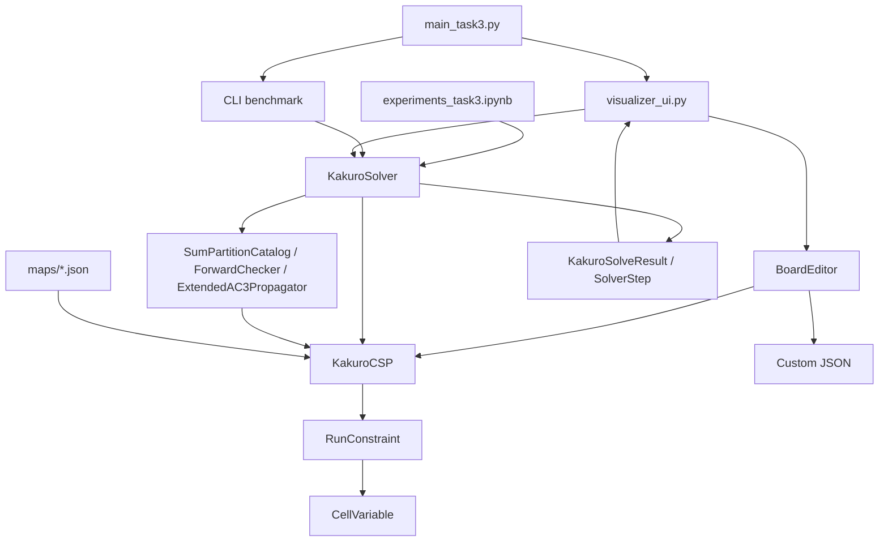

# TASK 3 — CONSTRAINT SATISFACTION PROBLEMS: KAKURO

**Môn học:** Nhập môn Trí tuệ nhân tạo (503043)  
**Đồ án:** Classical AI Suite  
**Phạm vi phụ trách:** Toàn bộ Task 3 (3.1, 3.2 và 3.3)  
**Tài liệu:** Phân tích nhiệm vụ, đọc hiểu mã nguồn, nội dung báo cáo và chuẩn bị vấn đáp

**Phiên bản đối chiếu:** `task3(1).zip` — bản người dùng cung cấp mới nhất trong cuộc trao đổi ngày 24/11/2026.

---

## Hướng dẫn sử dụng tài liệu

- **Phần I:** Phân tích yêu cầu, kiến thức nền tảng, thiết kế và cách hoạt động của từng module. Dùng để học và hiểu mã nguồn.
- **Phần II:** Bản thảo báo cáo Task 3 ở ngôi “em”, gồm phương pháp, kết quả thực nghiệm, đánh giá và kết luận. Có thể rút gọn và chuyển sang mẫu IEEE chung của nhóm.
- **Phần III:** Hướng dẫn demo, câu hỏi vấn đáp, bảng đối chiếu yêu cầu và các nội dung cần hoàn thiện trước khi nộp.

### Căn cứ và phạm vi xác minh

Tài liệu lấy **`task3(1).zip` làm căn cứ chính thức cho mọi nhận định về chương trình**; `AI Cuối Kì.pdf` (trang 1, 4–5, 7–11) chỉ dùng đối chiếu yêu cầu môn học. Đã đọc 7 module Python, 4 bảng JSON, README và toàn bộ 12 cell của Notebook trong ZIP mới. Đối chiếu byte cho thấy các module Python, JSON, README và Notebook đều giống bản `task3_updated.zip` trước đó. Tuy nhiên, ZIP mới không chứa `requirement.txt` hoặc thư mục `figures/`, dù README có nhắc đến chúng; không tính chúng là file hiện có. Các file cache `__pycache__` không phải mã nguồn cần báo cáo.

Số liệu benchmark trong Phần II lấy trực tiếp từ output của Notebook **trong ZIP mới**, không thay bằng các kết quả phiên bản trước hoặc thời gian chạy CLI một lần. Trong lần rà soát này, đã chạy lại `python main_task3.py --cli` trên bản giải nén (12/12 trường hợp hợp lệ), thực thi lại logic Cell 10 (20/20 kiểm tra đạt) và ghi trace Advanced trên bốn bảng để xác minh cơ chế tiền xử lý. Môi trường rà soát không có PyGame, nên không xác nhận kiểm thử giao diện thực tế. Không sửa các file nguồn của người dùng.

**Lưu ý:** PDF phân tích ban đầu ghi bảng 5×5 có 9 biến và 9×9 có 46 biến. Source hiện tại thực tế có 12 và 48 biến. Báo cáo này sử dụng số liệu thực tế trong JSON. Chưa có hình đề gốc để xác nhận độc lập rằng hai bảng hoàn toàn trùng khớp đề chính thức. Tài liệu không khẳng định đã kiểm thử toàn bộ thao tác GUI hoặc khả năng tương thích macOS. Tỷ lệ thành công chỉ áp dụng cho các trường hợp thực nghiệm đã chạy, không phải mọi bảng Kakuro.

---

# PHẦN I. PHÂN TÍCH VÀ ĐỌC HIỂU NHIỆM VỤ

## 1. Tổng quan nhiệm vụ được giao

Task 3 yêu cầu áp dụng phương pháp giải bài toán thỏa mãn ràng buộc (Constraint Satisfaction Problems — CSP) vào trò chơi Kakuro. Đây là một bài toán AI cổ điển: thay vì huấn luyện mô hình học máy, chương trình biểu diễn các điều kiện của câu đố và sử dụng tìm kiếm kết hợp suy luận để tìm một phép gán thỏa mãn tất cả điều kiện.

| Yêu cầu | Điểm theo tài liệu phân tích | Công việc thực hiện |
|---|---:|---|
| Task 3.1 — CSP Modeling | 1.0 | Mô hình hóa tập biến X, miền D, ràng buộc C; phân tích Backtracking, Forward Checking, Extended AC-3 và các heuristic. |
| Task 3.2 — Solver and Evaluation | 1.0 | Xây dựng bộ giải OOP, đọc dữ liệu, kiểm tra nghiệm, so sánh hiệu năng thuật toán trên các bảng kiểm thử. |
| Task 3.3 — Visualization | 1.0 | Xây dựng giao diện PyGame, hiển thị miền ứng viên, phép gán, lan truyền, ngõ cụt và quay lui; hỗ trợ từng bước và tự động. |

Phạm vi hiện tại bao gồm cả ba mục, không chỉ 3.1 và 3.2 như bảng phân công ban đầu. Ngoài yêu cầu cơ bản, ứng dụng có Board Editor, nhập số trước, chỉnh sửa hàng loạt, tạo lại tổng ngẫu nhiên, lưu/mở JSON và dừng phiên giải để chỉnh sửa.

Các ràng buộc kỹ thuật chung gồm OOP, chạy đa nền tảng, Notebook giữ output, báo cáo IEEE hai cột tối đa 5 trang cho **toàn bộ đồ án nhóm**, và vấn đáp. Tài liệu Markdown này là bản chi tiết phục vụ học và tổng hợp; không phải bản IEEE 5 trang hoàn chỉnh.

## 2. Hiểu luật Kakuro

Kakuro sử dụng lưới hai chiều gồm ba dạng ô:

- Ô trắng: cần điền một chữ số nguyên từ 1 đến 9.
- Ô đen thường: ngăn cách các dãy, không cần điền số.
- Ô đen gợi ý: chứa tổng ngang (góc trên bên phải) và/hoặc tổng dọc (góc dưới bên trái).

Một **run** là dãy ô trắng liên tiếp bắt đầu ngay sau hoặc ngay dưới một ô gợi ý, kết thúc khi gặp ô đen hoặc biên bảng. Mọi run phải thỏa mãn hai điều kiện đồng thời: tổng đúng bằng gợi ý và các số đôi một khác nhau. Không áp dụng AllDifferent cho cả hàng nếu hàng có nhiều run tách biệt. Một ô trắng thuộc một run ngang và một run dọc, nên giá trị của nó ảnh hưởng đồng thời tới hai nhóm ràng buộc.

Ví dụ, tổng ngang 4 của hai ô chỉ cho phép `(1,3)` hoặc `(3,1)`. Cặp `(2,2)` có tổng đúng nhưng vi phạm AllDifferent. Nếu một ô còn phải thuộc run dọc chỉ cho phép `{2,3}`, giao với miền `{1,3}` khiến ô đó chỉ còn `{3}`. Đây là ý tưởng thu hẹp miền.

## 3. Mô hình hóa CSP — Task 3.1

### 3.1. Tập biến X

Đặt `X = {x_(r,c) | (r,c) là tọa độ ô trắng}`. Ô đen không phải biến. Trong source, mỗi biến là `CellVariable`, khóa định danh là tuple `(row, col)` tính từ 0. UI chuyển sang tọa độ tính từ 1 để người dùng dễ quan sát.

| Bảng | Tổng số ô | Ô trắng / biến X | Ô không phải biến | Run ngang | Run dọc | Tổng run |
|---|---:|---:|---:|---:|---:|---:|
| 5×5 | 25 | 12 | 13 | 4 | 4 | 8 |
| 6×6 | 36 | 19 | 17 | 6 | 6 | 12 |
| 8×8 | 64 | 41 | 23 | 11 | 11 | 22 |
| 9×9 | 81 | 48 | 33 | 14 | 14 | 28 |

Mỗi run được lưu bằng một đối tượng `RunConstraint` chứa cả hai điều kiện. Vì vậy bảng 9×9 có 28 đối tượng run, tương đương 28 ràng buộc tổng và 28 ràng buộc AllDifferent nếu đếm riêng theo ý nghĩa toán học. Không nhầm số run với số cặp biến bất đẳng thức.

### 3.2. Miền giá trị D

Với mỗi biến chưa có dữ liệu nhập trước:

`D(x) = {1,2,3,4,5,6,7,8,9}`.

Nếu người dùng nhập trước số `g` (given digit), miền ban đầu là `{g}` và biến được đưa vào `assignment` ngay khi khởi tạo. Số nhập trước là điều kiện cố định, không phải giá trị AI được phép thay đổi khi quay lui.

Miền đang hoạt động là `DomainMap`, dạng `Dict[Tuple[int,int], Set[int]]`. Phép gán hiện tại là dictionary ánh xạ tọa độ sang chữ số. Hai cấu trúc khác nhau: một miền đơn không đồng nghĩa biến đã được đưa vào phép gán. Khi thử gán thật, solver đặt miền biến thành tập một phần tử và thêm giá trị vào assignment.

### 3.3. Tập ràng buộc C

Với mỗi run R gồm k biến `x1,...,xk`, có tổng gợi ý S:

$$\sum_{i=1}^{k}x_i = S$$

$$x_i \ne x_j \quad \forall i \ne j$$

Kèm điều kiện miền `1 ≤ xi ≤ 9` và điều kiện `x = g` đối với givens. Vì chỉ có chín chữ số khác nhau, mỗi run có tối đa 9 ô. Mã nguồn chấp nhận run có độ dài từ 1 đến 9; đây là phạm vi dữ liệu chương trình hỗ trợ, không phải khẳng định mọi biến thể luật Kakuro đều cho phép run một ô.

Một nghiệm là phép gán đầy đủ cho X thỏa mãn mọi ràng buộc. Chương trình tìm nghiệm đầu tiên và không đếm tất cả nghiệm, nên không khẳng định nghiệm duy nhất.

### 3.4. Ví dụ lấy trực tiếp từ bảng 5×5

Dùng quy ước `A/D` = tổng ngang/tổng dọc, `#` = ô đen, `0` = ô trắng. Dữ liệu trong `board_5x5_example.json` có thể biểu diễn bằng:

```text
#    #     0/21  0/14  #
#    12/14 0     0     0/11
21/0 0     0     0     0
11/0 0     0     0     0
#    16/0  0     0     #
```

Tọa độ trong ví dụ dưới đây tính từ 1 như UI. Ô `(4,2)` nằm trong run ngang có tổng 11 với 4 ô và run dọc có tổng 14 với 2 ô. Với 4 số khác nhau có tổng 11, tổ hợp duy nhất là `{1,2,3,5}`. Với 2 số khác nhau có tổng 14, tổ hợp là `{5,9}`, `{6,8}`. Giao hai tập ứng viên là `{5}`, vì vậy Sum Partitions thu hẹp miền của ô `(4,2)` xuống một giá trị.

Tương tự, ô `(5,4)` được thu hẹp xuống `{7}` ngay sau Sum Partitions. Điều này minh họa hiệu quả của kết hợp ràng buộc ngang/dọc trước khi tìm kiếm.

Một nghiệm Advanced thực tế của bảng 5×5:

```text
#    #     0/21  0/14  #
#    12/14 8     4     0/11
21/0 9     3     1     8
11/0 5     1     2     3
#    16/0  9     7     #
```

Kiểm tra run ngang: `8+4=12`; `9+3+1+8=21`; `5+1+2+3=11`; `9+7=16`. Run dọc: `8+3+1+9=21`; `4+1+2+7=14`; `9+5=14`; `8+3=11`. Mỗi run có các số khác nhau. Ví dụ này là nghiệm được bộ giải xác nhận, không phải dữ liệu lời giải được lưu sẵn trong JSON.

## 4. Các kỹ thuật AI trong chương trình

### 4.1. Backtracking Search — tìm kiếm quay lui

Backtracking xây dựng phép gán từng bước. Khi chọn biến, thuật toán thử một giá trị; nếu vi phạm điều kiện thì bỏ qua, nếu hợp lệ thì tiếp tục. Khi nhánh không thể hoàn thành nghiệm, thuật toán xóa phép gán vừa thử, khôi phục miền trước đó và chuyển sang ứng viên khác.

Điều kiện kiểm tra một phép gán dở dang trong `RunConstraint.is_consistent_partial()` gồm:

1. Không có chữ số đã gán nào trùng trong run.
2. Nếu run đã được gán đầy đủ, tổng phải đúng.
3. Nếu còn ô chưa gán, đặt `R = S - tổng các chữ số đã gán` và `m = số ô chưa gán`.
4. Lấy danh sách chữ số 1–9 chưa dùng trong run. Tổng nhỏ nhất là tổng m số nhỏ nhất còn dùng được; tổng lớn nhất là tổng m số lớn nhất còn dùng được.
5. Nếu `R` không nằm giữa hai cận, phép gán không khả thi.

Ví dụ: run tổng 15, đã gán 8, còn hai ô. Tổng còn lại là 7; có thể tồn tại tổ hợp 1+6 hoặc 2+5 hoặc 3+4. Nếu đã gán 8 và 9, tổng 17 vượt 15 nên nhánh bị loại. Kiểm tra cận này là điều kiện cần, chưa xét mọi miền hiện tại của các ô còn lại.

**Điểm quan trọng về baseline:** `PLAIN_BT` không phải vét cạn mù quáng. Nó vẫn kiểm tra AllDifferent và cận tổng trước mỗi phép gán, nhưng không tiền xử lý Sum Partitions, không Forward Checking, không Extended AC-3 và không dùng heuristic chọn biến. Đây là đường cơ sở hợp lý để so sánh các cấu hình trong source.

### 4.2. Sum Partitions — phân tích tổ hợp tổng

`SumPartitionCatalog.initialize()` dùng `itertools.combinations` để tạo mọi tổ hợp không rỗng của các số 1–9 không lặp, rồi phân nhóm theo khóa `(length, target_sum)` trong `_CACHE`. Có `2^9 - 1 = 511` tập con không rỗng. Cache dùng lại giữa các lần giải.

`allowed_digits(k, S, forbidden)` trả về hợp các chữ số xuất hiện trong ít nhất một tổ hợp có độ dài k, tổng S và không chứa số bị cấm. Tại tiền xử lý, `preprocess_node_domains()` lấy giao miền ban đầu với tập ứng viên run ngang và run dọc.

Lợi ích: loại bỏ các giá trị chắc chắn không thể xuất hiện trong một run từ rất sớm. Hạn chế: tập hợp các chữ số xuất hiện trong một tổ hợp không đảm bảo một giá trị có thể phối hợp với miền riêng của mọi ô trong run. Extended AC-3 xử lý mạnh hơn ở bước tiếp theo.

### 4.3. Forward Checking (FC)

Sau khi gán `x=v`, `ForwardChecker.propagate()` xét hai run chứa x. Với mỗi run, lấy các giá trị đã gán, số ô chưa gán `k_rem` và tổng còn lại `sum_rem`. Gọi `allowed_digits(k_rem, sum_rem, assigned_vals)` để tìm các chữ số có thể sử dụng trong phần còn lại, rồi giao với miền của từng ô chưa gán. Nếu không có tổ hợp hoặc miền bị rỗng, trả về thất bại.

Ví dụ run tổng 6 với ba ô. Sau khi gán ô đầu = 1, hai ô sau chỉ có thể dùng 2 và 3, không thể dùng lại 1. Nếu một ô sau có miền `{1,4}` thì giao với `{2,3}` rỗng, nhánh thất bại ngay.

FC trong chương trình mạnh hơn cách chỉ xóa số vừa gán khỏi các ô lân cận vì nó còn xét tổng còn lại. Tuy nhiên, nó không kiểm tra đầy đủ tổ hợp dựa trên miền riêng của mọi ô, cũng không tự lan truyền qua tất cả các run giao nhau đến điểm cố định. Do đó vẫn có thể tồn tại mâu thuẫn chưa được phát hiện ở xa biến vừa gán.

### 4.4. Extended AC-3 — nhất quán cung tổng quát

AC-3 cổ điển xử lý các cung của ràng buộc nhị phân. Kakuro có ràng buộc tổng và AllDifferent nhiều biến. Source dùng cách mở rộng theo **Generalized Arc Consistency (GAC)** trên cả run, chứ không chỉ áp dụng AC-3 nhị phân hoặc chỉ kiểm tra min/max.

`ExtendedAC3Propagator.propagate()` duy trì hàng đợi `deque` các run. Lúc tiền xử lý, toàn bộ run được đưa vào hàng đợi. Sau một phép gán, hàng đợi bắt đầu từ các run chứa biến vừa gán và các biến có miền bị Forward Checking thay đổi. `in_queue` tránh đưa cùng một run vào hàng đợi nhiều lần đồng thời.

`_revise_run()` xét từng ứng viên của từng biến chưa gán. Ứng viên bị loại nếu trùng giá trị đã gán hoặc không có một tổ hợp hỗ trợ trên các miền còn lại thỏa mãn tổng và không lặp. Khi miền đổi, các run giao nhau với ô đó được đưa vào hàng đợi để kiểm tra tiếp. Quá trình lặp đến khi hàng đợi rỗng hoặc phát hiện mâu thuẫn.

`_has_support()` dùng DFS đệ quy để kiểm tra sự tồn tại của tổ hợp hỗ trợ. Với `m` ô còn lại và các miền đã bỏ số sử dụng:

- Nếu có miền rỗng hoặc số chữ số khác nhau trong hợp các miền nhỏ hơn m, trả về False.
- Cận dưới là giá trị lớn hơn giữa tổng các min riêng và tổng m chữ số nhỏ nhất trong hợp miền.
- Cận trên là giá trị nhỏ hơn giữa tổng các max riêng và tổng m chữ số lớn nhất trong hợp miền.
- Nếu tổng mục tiêu nằm ngoài hai cận, loại nhánh ngay; nếu còn khả thi, thử lần lượt chữ số chưa sử dụng và giảm tổng còn lại.
- Khi không còn ô, trả về True nếu tổng còn lại bằng 0.

Ví dụ `x+y+z=10`, x=7, `D(y)=D(z)={2,3,4}`. Tổng cần còn lại bằng 3 nhưng cận dưới ít nhất 4 (và nếu xét hai số khác nhau thì ít nhất 5), vì vậy không có hỗ trợ. Một ví dụ phân biệt cận và hỗ trợ đầy đủ: `x+y=5`, `D(x)=D(y)={1,3,4}`. Khi thử x=3, y phải bằng 2, không thuộc miền của y. Chỉ kiểm tra tổng nằm giữa min/max có thể bỏ sót; kiểm tra hỗ trợ sẽ loại x=3.

Một giá trị được giữ lại do có hỗ trợ trong từng run không có nghĩa chắc chắn thuộc một nghiệm toàn cục. Các giao điểm có thể còn phụ thuộc vòng; Backtracking vẫn cần thiết. Phương pháp này không biến Kakuro thành bài toán luôn giải được trong thời gian đa thức. Việc duy trì nhất quán trong quá trình tìm kiếm tương ứng ý tưởng MAC (Maintaining Arc Consistency).

### 4.5. MRV — Minimum Remaining Values

MRV chọn biến chưa gán có miền nhỏ nhất, ưu tiên giải biến ít lựa chọn nhất để sớm phát hiện nhánh không khả thi (fail first).

Ví dụ: `D(A)={1,3,5}`, `D(B)={2,4}`, `D(C)={1,2,3,4}`. Chọn B vì chỉ có hai ứng viên. Nếu một biến có miền đơn, nó được ưu tiên nhưng vẫn cần sự kiện gán để đưa vào assignment.

### 4.6. Degree Heuristic

Khi nhiều biến cùng có MRV nhỏ nhất, chọn biến có nhiều peer **chưa gán** nhất. Peer là các ô trắng khác cùng run ngang hoặc dọc, không phải toàn bộ hàng/cột và không đơn giản là đếm hai run của biến (hầu hết biến đều có hai run).

Trong Advanced, khóa lựa chọn thực tế là `(len(domain), -unassigned_degree, pos)`. Vì lấy min, degree lớn được ưu tiên; nếu vẫn hòa thì tọa độ nhỏ hơn được chọn. Chế độ BT_FC chỉ dùng MRV đơn giản, phá hòa theo thứ tự row-major có sẵn.

### 4.7. LCV — Least Constraining Value

LCV quyết định thứ tự thử giá trị sau khi đã chọn biến. Với mỗi ứng viên, `_order_domain_values()` tạo bản sao assignment và tất cả miền, gán thử, chạy FC và Extended AC-3 trên trạng thái giả định. Điểm ảnh hưởng là tổng số ứng viên bị mất ở các biến khác chưa gán. Khóa sắp xếp `(0 nếu khả thi, 1 nếu không; số ứng viên bị mất; giá trị)` đưa ứng viên khả thi lên trước, rồi ưu tiên mức ảnh hưởng thấp nhất. Nếu chỉ còn một ứng viên, không cần mô phỏng.

Các lần mô phỏng LCV không làm thay đổi trạng thái thật và không cộng vào Nodes Tried, Backtracks hoặc Pruned Values; chi phí thời gian vẫn nằm trong thời gian tìm kiếm. Ứng viên không khả thi trong phép thử LCV được xếp sau, không nhất thiết bị xóa ngay khỏi danh sách thử thật. LCV là heuristic, không đảm bảo luôn tìm được nghiệm nhanh nhất.

### 4.8. So sánh ba cấu hình triển khai

| Kỹ thuật | Basic (`PLAIN_BT`) | FC + MRV (`BT_FC`) | Advanced (`BT_MAC_HEURISTICS`) |
|---|:---:|:---:|:---:|
| Backtracking + kiểm tra cận tổng/AllDifferent | Có | Có | Có |
| Sum Partitions | Không | Có | Có |
| Forward Checking | Không | Có | Có |
| MRV | Không | Có | Có |
| Degree | Không | Không | Có |
| Extended AC-3 | Không | Không | Có |
| LCV | Không | Không | Có |
| Thứ tự thử giá trị | Tăng dần | Tăng dần | LCV, sau đó tăng dần nếu hòa |

Ba cấu hình dùng chung mô hình, cùng kiểm tra nghiệm, cùng giới hạn tìm kiếm. So sánh này đo hiệu quả của **nhóm kỹ thuật**, không phải thí nghiệm tách riêng ảnh hưởng của từng heuristic.

### 4.9. Độ phức tạp

Nếu n là số biến, d là kích thước miền tối đa (d=9), không gian tìm kiếm thô của Backtracking có thể đạt `O(d^n)` trong trường hợp xấu nhất, chưa kể chi phí kiểm tra ràng buộc tại mỗi nút. Mỗi lần sao lưu miền cần `O(n*d)` không gian; nếu giữ bản sao ở mỗi mức đệ quy thì chi phí miền của ngăn xếp tìm kiếm có thể đạt `O(n^2*d)`. Ghi snapshot còn tăng bộ nhớ theo số bước lưu và số biến.

MRV và Degree phải duyệt biến/peer chưa gán. FC và GAC tốn chi phí kiểm tra tổ hợp; kiểm tra hỗ trợ trên run có thể tăng theo số cách gán các chữ số khác nhau, nhưng run chỉ dài tối đa 9. LCV có thể phải thực hiện lan truyền cho nhiều ứng viên trước mỗi phép gán. Các kỹ thuật giảm số nhánh thực tế, không bảo đảm giảm độ phức tạp trường hợp xấu nhất hoặc luôn giảm thời gian.

---

## 5. Thiết kế và đọc hiểu mã nguồn — Task 3.2

### 5.1. Cấu trúc thư mục hiện tại

```text
source/task3/
├── __init__.py
├── csp_model.py
├── propagation.py
├── solver.py
├── board_editor.py
├── visualizer_ui.py
├── main_task3.py
├── README.md
├── experiments_task3.ipynb
└── maps/
    ├── board_5x5_example.json
    ├── board_6x6_medium.json
    ├── board_8x8_hard.json
    └── board_9x9_complex.json
```

Cây trên biểu diễn các file thực sự có trong `task3(1).zip` (đặt tại `source/task3/` khi ghép vào dự án nhóm); bỏ qua `__pycache__/` gồm các file `.pyc` tự sinh. ZIP không có `tests/`, `requirement.txt`, `figures/` hoặc `maps/custom/`. Hai thư mục sau có thể được tạo khi chạy Notebook hoặc lưu bảng tùy chỉnh. README mô tả `requirement.txt` nhưng file này chưa có trong ZIP mới. 20 kiểm tra bổ sung nằm trong Cell 10 của Notebook, không phải 20 bài Unit Test riêng.

### 5.2. Kiến trúc tổng thể



Kiến trúc phân tách dữ liệu, mô hình ràng buộc, suy luận, tìm kiếm và giao diện. Notebook/CLI có thể gọi bộ giải mà không cần PyGame. UI không tự tính lời giải mà nhận kết quả và snapshot từ solver.

### 5.3. `csp_model.py` — mô hình X, D, C

| Lớp / thuộc tính | Vai trò |
|---|---|
| `CellVariable` | Biểu diễn một ô trắng; row, col, domain mặc định, across_run, down_run; `pos` và `peer_positions()` giúp định danh và truy xuất các biến liên quan. |
| `RunConstraint` | Đại diện một run; có run_id, orientation, clue_pos, target_sum, variables và length. |
| `KakuroCSP` | Quản lý raw_grid, variables, ordered_positions, runs, peers, givens, kích thước và tên bài toán. |

| Phương thức | Cách hoạt động |
|---|---|
| `from_json()` / `from_dict()` | Đọc JSON, kiểm tra cấu trúc dữ liệu và danh sách givens; chuyển thành đối tượng CSP. |
| `_build_csp()` | Duyệt lưới tìm ô W; từ mỗi clue, quét phải hoặc xuống đến khi gặp ô không trắng; tạo run và liên kết biến; kiểm tra mọi biến có cả hai run; tạo peer map. |
| `initial_domains()` | Tạo dictionary miền độc lập từ 1–9 hoặc singleton với givens. |
| `is_consistent_partial()` | Kiểm tra số trùng, tổng đầy đủ, cận tổng còn lại dựa trên chữ số chưa dùng. |
| `is_consistent()` | Tạm gán ứng viên, kiểm tra hai run liên quan, khôi phục assignment cũ trước khi trả kết quả. |
| `is_satisfied_complete()` | Kiểm tra tất cả biến của một run đã gán, tổng và AllDifferent đúng. |
| `verify_solution()` | Kiểm tra tập khóa đúng bằng tập biến, giá trị nguyên 1–9, givens giữ nguyên và mọi run thỏa mãn. |

Mô hình kiểm tra lưới chữ nhật không rỗng; ô phải là W, B hoặc object có khóa across/down hợp lệ, tổng 1–45; clue phải trỏ đến ít nhất một ô trắng; mỗi run dài 1–9; mọi ô trắng có cả hai run; givens phải ở ô trắng và thuộc miền. Cấu trúc hợp lệ chưa đảm bảo có nghiệm. Kiểm tra cận tổng cục bộ được thực hiện thêm trong editor/solver.

### 5.4. `propagation.py` — lan truyền ràng buộc

| Lớp / phương thức | Vai trò |
|---|---|
| `SumPartitionCatalog.initialize()` | Tạo và cache các tổ hợp chữ số theo độ dài/tổng. |
| `allowed_digits()` | Trả hợp chữ số từ các tổ hợp hợp lệ không chứa số bị cấm. |
| `preprocess_node_domains()` | Thu hẹp miền ban đầu bằng giao tập ứng viên hai run. |
| `ForwardChecker.propagate()` | Lọc miền các biến chưa gán thuộc run chứa biến vừa gán. |
| `ExtendedAC3Propagator.propagate()` | Quản lý hàng đợi run và lan truyền khi miền thay đổi. |
| `_revise_run()` | Kiểm tra từng ứng viên có tổ hợp hỗ trợ trong run hay không. |
| `_has_support()` | DFS với kiểm tra min/max và chữ số đã dùng. |

`PrunedRecord` lưu các giá trị bị loại theo tọa độ. Nó giúp solver tổng hợp chỉ số và cung cấp dữ liệu cho UI tô màu. Propagation sửa miền đang xét, không trực tiếp sửa raw_grid và không tự gán mọi singleton vào assignment.

### 5.5. `solver.py` — điều phối thuật toán

| Thành phần | Vai trò |
|---|---|
| `SolverMode` | Enum ba cấu hình tìm kiếm. |
| `SolverStep` | Snapshot độc lập: step_type, focus_pos, value, assignment, domains, pruned, message, nodes_so_far, backtracks_so_far. |
| `KakuroSolveResult` | Kết quả tổng hợp: puzzle_name, mode, solved, assignment, elapsed_ms, nodes_explored, backtracks, pruned_values, valid_verified, steps_trace, status, trace_truncated. |
| `SearchCancelled` | Ngoại lệ dùng để thoát khỏi phiên tìm kiếm bị hủy. |
| `KakuroSolver` | Khởi tạo, tiền xử lý, tìm kiếm, đếm chỉ số, ghi trace và trả kết quả. |

Luồng của `solve()` / `_solve()`:

1. Xóa các bộ đếm và trạng thái của lần giải trước; tạo assignment từ givens và miền ban đầu.
2. Kiểm tra tính nhất quán cục bộ của givens; ghi INITIAL nếu bật trace.
3. Basic giữ miền gốc; FC chạy Sum Partitions; Advanced chạy Sum Partitions và Extended AC-3 ban đầu. FC còn lan truyền từ các givens đã có nếu trạng thái ban đầu khả thi.
4. Nếu còn khả thi, gọi `_backtrack()`; nếu miền rỗng hoặc givens mâu thuẫn thì không cần tìm kiếm.
5. Đo thời gian nội bộ, xác minh nghiệm tìm được, tạo trạng thái cuối và `KakuroSolveResult`.
6. Nếu nhận yêu cầu hủy, bắt `SearchCancelled` và trả `CANCELLED` thay vì `UNSAT`.

Luồng `_backtrack()` (mô tả thuật toán, không phải mã nguồn thay thế):

```text
Kiểm tra yêu cầu hủy
Nếu mọi biến đã gán: trả kết quả verify_solution
Nếu vượt node_limit: đánh dấu NODE_LIMIT, trả thất bại
Chọn biến chưa gán theo cấu hình
Sắp xếp các ứng viên theo cấu hình
Với mỗi ứng viên:
    Kiểm tra hủy và giới hạn, tăng bộ đếm lượt thử
    Nếu vi phạm ràng buộc: ghi REJECT và thử ứng viên khác
    Sao lưu tất cả miền
    Gán biến và đặt miền đơn; ghi ASSIGN
    Lan truyền theo chế độ nếu cần; ghi PRUNE / FAILURE
    Nếu khả thi và lời gọi đệ quy thành công: trả thành công
    Xóa phép gán; khôi phục toàn bộ miền; tăng Backtracks
    Nếu đã chạm giới hạn: trả thất bại
Hết ứng viên: trả thất bại
```

Khôi phục miền bằng `domains.clear()` và `domains.update(saved_domains)` để giữ đối tượng dictionary mà các mức đệ quy đang dùng chung. `saved_domains` sao chép từng tập set, không dùng bản sao nông của dictionary vì khi set bên trong bị sửa, bản sao nông vẫn có thể bị ảnh hưởng. Givens không nằm trong tập biến chưa gán nên không bị quay lui.

`_select_unassigned_variable()` cài đặt row-major, MRV hoặc MRV+Degree. `_order_domain_values()` cài đặt thứ tự tăng dần hoặc LCV. `_count_pruned()` cộng số giá trị bị loại trong lan truyền thật. `_merge_pruned()` hợp các danh sách giá trị loại trong cùng một sự kiện. `_emit()` sao chép assignment, domains và pruned để UI có thể quay lại lịch sử mà không làm thay đổi solver.

**Giới hạn:** solver mặc định 300.000 lượt thử, `max_recorded_steps=2500` nếu người gọi không đổi; UI truyền 30.000. Khi trace chạm giới hạn, các sự kiện trung gian có thể bị bỏ qua nhưng vẫn dành chỗ cho SOLVED/UNSAT/NODE_LIMIT. Kết quả hủy trả riêng CANCELLED, không phải một trace hoàn chỉnh để phát lại.

### 5.6. Ý nghĩa OOP của thiết kế

Mỗi lớp có trách nhiệm riêng: biến và run mô hình hóa dữ liệu, CSP quản lý cấu trúc, lớp propagation cung cấp chiến lược suy luận, solver quản lý vòng đời tìm kiếm, editor quản lý bản nháp và UI điều khiển hiển thị. `KakuroCSP` chứa các `CellVariable` và `RunConstraint`; các run giữ tham chiếu đến biến của mình. UI sử dụng các đối tượng editor, CSP và result thay vì trộn thuật toán vào hàm vẽ.

Tính đóng gói thể hiện qua các phương thức kiểm tra và xử lý trạng thái; các classmethod hỗ trợ khởi tạo mô hình và tái sử dụng catalog. Source dùng dataclass và Enum để chuẩn hóa dữ liệu. Không cần gán cho dự án các cơ chế kế thừa/đa hình phức tạp không thực sự xuất hiện trong code.

## 6. Board Editor và giao diện — Task 3.3

### 6.1. `board_editor.py`

`BoardEditor` giữ bản sao `grid` và `givens` của bài toán, cho phép chỉnh sửa mà không làm biến đổi CSP đang được giải hoặc file mẫu trên đĩa. Khi giải, `to_csp()` tạo đối tượng `KakuroCSP` mới từ bản nháp.

| Phương thức | Ý nghĩa |
|---|---|
| `run_cells()` | Tìm dãy trắng liền kề theo hướng across/down. |
| `set_clue()` | Sửa tổng của một hướng có run, từ 1 đến 45. |
| `set_given()` | Nhập số 1–9 hoặc 0 để xóa given. |
| `set_cell_type()` | Đổi trắng/đen, xóa given của ô thay đổi, không cho chuyển hàng/cột đầu thành trắng qua thao tác này. |
| `synchronize_clues()` | Cập nhật hướng gợi ý khi bố cục thay đổi; giữ tổng cũ nếu hướng còn tồn tại, tạo tổng mặc định cho run mới. |
| `new(size)` | Tạo bảng vuông 3–9; hàng/cột đầu chứa gợi ý, các ô bên trong trắng; tổng được tạo từ mẫu chữ số tuần hoàn. |
| `bulk_rows()` / `apply_bulk_rows()` | Xuất/nhập dữ liệu dạng token từng hàng; dựng CSP tạm để kiểm tra trước khi thay bản nháp. |
| `randomize_clues()` | Sinh lại các tổng từ một phép điền chữ số hợp lệ theo bố cục hiện tại, xóa givens. |
| `validate()` | Kiểm tra cấu trúc và cận tổng/givens của từng run; không chứng minh nghiệm toàn cục. |
| `save()` / `load()` | Lưu/mở JSON gồm name, grid và givens. |

**Bulk Edit:** `#` là ô đen; `0` là ô trắng trống; `1`–`9` là given; `A/D` là tổng ngang/dọc, số 0 nghĩa không có hướng đó. Mỗi hàng có đúng số token bằng số cột, phân cách bằng khoảng trắng. Dữ liệu sai cấu trúc bị từ chối trước khi cập nhật. Một bản nháp đúng cấu trúc vẫn có thể vô nghiệm.

Ví dụ:

```text
# 0/4 0/6
3/0 1 0
7/0 0 4
```

Nghiệm là hai hàng trắng `[1,2]` và `[3,4]`. Số 1 và 4 là givens. Đây cũng là trường hợp trong Notebook kiểm tra cả ba solver.

**Randomize All Clues:** Trong phạm vi UI (tối đa 9 hàng/cột), phương thức xáo trộn chữ số 1–9 và hai danh sách chỉ số hàng/cột 0–8, rồi dùng công thức `digits[(ro[r]+co[c]) % 9]` để tạo một cấu hình khác nhau theo mỗi hàng/cột. Tính tổng từng run từ cấu hình này để sinh gợi ý. Giữ nguyên bố cục và xóa givens cũ. Vì tổng được tạo từ một phép điền hợp lệ, tồn tại ít nhất một nghiệm. Không lưu đáp án tạo bảng trong dữ liệu trả về; solver vẫn phải tìm nghiệm. Không đảm bảo nghiệm duy nhất, độ khó cao, hay tất cả tổng đều đổi (tối đa 100 lần thử để tìm grid khác).

Khi người dùng chỉ sửa một tổng ngang mà không sửa các tổng dọc liên quan, bài toán dễ vô nghiệm. Điều kiện cần hữu ích là tổng tất cả clue ngang phải bằng tổng tất cả clue dọc vì mỗi ô trắng được đếm đúng một lần theo mỗi hướng. `validate()` hiện kiểm tra theo từng run, không có kiểm tra tổng toàn cục riêng. Nên dùng bộ giải để xác nhận nghiệm.

### 6.2. `visualizer_ui.py`

Giao diện PyGame tiếng Anh dùng cửa sổ logic 1160×740, có thể thay đổi kích thước cửa sổ. `ControlButton` lưu rect, label, action_id và trạng thái nút. `KakuroVisualizerUI` quản lý bảng đang chọn, chế độ giải, editor, result, bước trình chiếu, tốc độ, ô/trường đang sửa, queue và cancel event.

**Solver Mode:** lựa chọn bảng mẫu, thuật toán, Auto Play/Pause, Previous/Next Step, Reset, Final State, Solve Again, Speed, Edit Board/Stop & Edit. Phím Space phát/dừng, mũi tên trái/phải chuyển bước, 0 về đầu, Esc về editor (khi không ở trường nhập liệu). Mặc định bảng 5×5, Advanced, tốc độ 220 ms/step.

**Editor Mode:** chọn bảng mẫu, chọn kích thước 3×3–9×9, tạo bảng, khôi phục mẫu, đổi loại ô, sửa across/down, nhập given, Bulk Edit All Cells, Randomize All Clues, Clear All Givens, Validate Board, Save/Load JSON và Solve Current Board. Tên file tương đối lưu trong `maps/custom/`; có thể nhập đường dẫn tuyệt đối. UI chấp nhận bảng mở có 3–9 hàng và 3–9 cột.

### 6.3. Giải thích toàn bộ chỉ số và sự kiện trên UI

| Chỉ số | Ý nghĩa đúng theo source |
|---|---|
| Assigned Cells | Số phần tử trong assignment của snapshot / số biến X. Bao gồm givens; có thể giảm sau backtrack. |
| Nodes Tried | Số lượt thử ứng viên thật, kể cả ứng viên bị REJECT trước khi gán. Không tính mô phỏng LCV. |
| Backtracks | Số lần hủy một phép gán đã thực hiện khi nhánh không thành công (có thể gồm việc thu hồi khi giới hạn tìm kiếm được chạm). REJECT trước khi gán không làm tăng chỉ số này. |
| Solve Time | Thời gian nội bộ của toàn bộ lần giải, tính bằng ms; có chi phí ghi trace nếu bật. Không tính phát lại, không tính bước verify cuối bên ngoài khoảng đo; kiểm tra ở lá tìm kiếm vẫn nằm trong thời gian đo. |
| Step i/N | Vị trí snapshot đang xem / tổng snapshot được lưu. Không đồng nghĩa số nút. Có thể bị lược bớt sự kiện nếu vượt giới hạn trace. |
| Speed | Khoảng chờ giữa hai snapshot, từ 25–1200 ms/step; càng nhỏ trình chiếu càng nhanh. Không tăng tốc thuật toán. |

| Sự kiện trong code | Nhãn UI | Ý nghĩa |
|---|---|---|
| INITIAL | Initialization | Khởi tạo assignment và miền. |
| PREPROCESS | Preprocessing | Tiền xử lý tùy mode; Basic giữ miền ban đầu. |
| SELECT_VAR | Select variable | Chọn biến chưa gán. |
| ASSIGN | Assign value | Gán ứng viên đã qua kiểm tra cục bộ. |
| PRUNE | Prune candidates | Loại ứng viên qua suy luận. |
| REJECT | Reject value | Bỏ ứng viên không nhất quán trước khi gán. |
| FAILURE | Dead end | Lan truyền thất bại, run mất hỗ trợ hoặc miền rỗng. |
| BACKTRACK | Backtrack | Hủy phép gán, khôi phục miền. |
| SOLVED | Solution found | Nghiệm đã xác minh. |
| UNSAT | No solution | Không tìm được nghiệm sau khi loại mâu thuẫn hoặc duyệt hết tìm kiếm không bị giới hạn. |
| NODE_LIMIT | Search limit reached | Đã chạm giới hạn lượt thử; chưa thể kết luận vô nghiệm. |

`CANCELLED` là trạng thái kết quả hủy; UI trở lại editor thay vì phát tiếp trace. Trong grid, ô trắng chứa các số nhỏ là miền hiện tại, số lớn là giá trị đã gán, chữ G/màu tím là given, xanh dương là biến đang xét, đỏ/gạch ngang là ứng viên bị loại, cam là từ chối/ngõ cụt/quay lui, nền xanh lá là bước SOLVED, dấu x báo miền rỗng. Snapshot lưu theo sự kiện tổng hợp chứ không hiển thị từng thao tác đệ quy nội bộ của `_has_support()` hoặc mô phỏng LCV. Ví dụ, trên bảng 5×5 Advanced, trace thực tế mở đầu như sau (tọa độ hiển thị từ 1):

| Step | Sự kiện | Ô đang xét / giá trị | Assigned Cells | Nodes Tried | Backtracks | Ứng viên loại trong bước |
|---:|---|---|---|---:|---:|---:|
| 1 | INITIAL | — | 0/12 | 0 | 0 | 0 |
| 2 | PREPROCESS | — | 0/12 | 0 | 0 | 96 |
| 3 | SELECT_VAR | (3,3) | 0/12 | 0 | 0 | 0 |
| 4 | ASSIGN | (3,3) = 3 | 1/12 | 1 | 0 | 0 |
| 5 | SELECT_VAR | (4,4) | 1/12 | 1 | 0 | 0 |
| 6 | ASSIGN | (4,4) = 2 | 2/12 | 2 | 0 | 0 |
| 27 | SOLVED | — | 12/12 | 12 | 0 | 0 |

Nguồn: chạy `KakuroSolver` chế độ Advanced có ghi trace trên `board_5x5_example.json` trong ZIP mới. Đây là các snapshot được xác nhận bằng bộ giải, không phải ảnh chụp giao diện. Ở PREPROCESS, 96 ứng viên bị loại vì ban đầu có 12 × 9 = 108 ứng viên, sau đó còn 12 miền đơn; chưa có ô nào được gán. Dùng ví dụ này để giải thích vì sao Step, Assigned Cells và Nodes Tried là các chỉ số khác nhau.

### 6.4. Cơ chế Step, Auto Play, Stop & Edit

Chương trình không thực hiện một phép gán mới mỗi lần bấm Next. Nó tính trước trace rồi phát lại các snapshot độc lập. Do đó Previous Step chỉ đổi chỉ số hiển thị, không đảo ngược phép tính thật. Pause chỉ dừng phát lại.

Khi `start_solve()` chạy, chương trình xác lập CSP và mode hiện tại, tạo `threading.Event` và `Queue` mới, rồi khởi tạo worker `Thread(daemon=True)` để giải có trace. UI tiếp tục vòng lặp PyGame và `poll()` lấy kết quả khi sẵn sàng. Trong lúc busy, nút Stop & Edit vẫn được phép hoạt động. Khi dừng, event cũ được set, queue được thay thế, kết quả và lịch sử cũ bị xóa khỏi UI, tạo bản nháp từ dữ liệu đầu vào của CSP. Worker cũ giữ queue riêng nên không đưa kết quả cũ vào phiên mới. Sau chỉnh sửa, Solve Current Board xây dựng CSP mới và bắt đầu lại.

Đây là hủy hợp tác: solver kiểm tra event tại các điểm trong tìm kiếm, LCV và vòng lan truyền. Không cưỡng chế kết thúc thread tức thì; DFS kiểm tra hỗ trợ không tự kiểm tra event tại mọi lời gọi đệ quy. Ngoài ra, lần khởi tạo UI và `_reload_problem()` vẫn chạy đồng bộ; không khẳng định mọi đường khởi chạy đều có thể dừng tức thời. Phải kiểm thử thao tác Stop & Edit trực tiếp trong cửa sổ trước khi nộp.

### 6.5. `main_task3.py`, môi trường và dữ liệu

Entry point sử dụng argparse và pathlib, tự thêm thư mục cha vào import path. Có ba cách chạy (tại thư mục `source/task3/`):

```bash
python main_task3.py
python main_task3.py --cli
python main_task3.py --headless-screenshot kakuro.png
```

Lệnh đầu mở UI, lệnh thứ hai đo mỗi cấu hình một lần trên bốn bảng, lệnh thứ ba cần PyGame và SDL dummy driver để xuất ảnh minh họa bảng 9×9 với FC + MRV nếu đủ các bảng mẫu theo thứ tự ưu tiên. CLI dùng thư viện chuẩn Python, không yêu cầu UI. Notebook dùng NumPy, pandas, Matplotlib, Jupyter/IPython; nbclient là công cụ tùy chọn phục vụ thực thi tự động. Không cần python-sat, TensorFlow hoặc PyTorch cho Task 3.

**Điểm cần bổ sung trước khi nộp:** ZIP mới không có `requirement.txt` riêng. Vì vậy nếu chưa có môi trường chung, có thể cài bằng `python -m pip install pygame numpy pandas matplotlib jupyter` (và `nbclient` nếu chạy Notebook tự động), hoặc bổ sung file requirement tương ứng. README khuyến nghị Python 3.10–3.12; Notebook lưu output từ Python 3.13.5. Không coi phiên bản Python trong file `.pyc` là bằng chứng về môi trường benchmark.

JSON sử dụng `B`, `W`, `{"across": S, "down": T}` và danh sách `givens` tùy chọn gồm row, col, value (tọa độ từ 0). Ví dụ 3×3:

```json
{
  "name": "Custom 3x3",
  "grid": [["B", {"down": 4}, {"down": 6}],
           [{"across": 3}, "W", "W"],
           [{"across": 7}, "W", "W"]],
  "givens": [{"row": 1, "col": 1, "value": 1},
             {"row": 2, "col": 2, "value": 4}]
}
```

---

# PHẦN II. NỘI DUNG BÁO CÁO TASK 3

> Đây là bản thảo nội dung báo cáo cá nhân, viết ở ngôi “em”. Khi đưa vào báo cáo IEEE chung, nhóm có thể chuyển sang ngôi “nhóm” hoặc văn phong khách quan và rút gọn theo giới hạn 5 trang. Giữ nguyên số liệu hoặc thay thế toàn bộ bằng output mới nếu chạy lại Notebook trên máy cá nhân.

## 7. Tóm tắt (Abstract — nội dung riêng Task 3)

Trong Task 3, em thực hiện xây dựng hệ thống giải và trực quan hóa trò chơi Kakuro dựa trên bài toán thỏa mãn ràng buộc (Constraint Satisfaction Problem — CSP). Mỗi ô trắng được biểu diễn thành một biến có miền chữ số từ 1 đến 9, chịu đồng thời ràng buộc tổng và không trùng lặp trong các dãy ngang, dọc. Bộ giải được tổ chức theo hướng đối tượng với ba cấu hình: Backtracking cơ bản; Backtracking kết hợp Sum Partitions, Forward Checking và MRV; và Backtracking nâng cao kết hợp Extended AC-3, MRV, Degree Heuristic và LCV cùng các kỹ thuật tiền xử lý và lan truyền trước đó. Em đánh giá các cấu hình trên bốn bảng từ 5×5 đến 9×9, mỗi cấu hình được đo 30 lần. Kết quả lưu trong Notebook cho thấy 360/360 lượt giải tìm được nghiệm hợp lệ; cấu hình nâng cao giảm hơn 99% số lượt thử ứng viên so với phương pháp cơ bản trên cả bốn bảng. Tuy nhiên, Forward Checking kết hợp MRV đạt thời gian trung bình thấp nhất trong lần thực nghiệm này. Hệ thống còn cung cấp giao diện PyGame hỗ trợ trực quan hóa từng bước tìm kiếm, chỉnh sửa dữ liệu, tạo lại gợi ý và giải lại bài toán, giúp minh họa mối liên hệ giữa lý thuyết CSP và quá trình giải thực tế.

**Từ khóa:** Kakuro, Constraint Satisfaction Problem, Backtracking, Forward Checking, Generalized Arc Consistency, MRV, Degree Heuristic, LCV.

## 8. Giới thiệu và mục tiêu thực hiện

Kakuro là bài toán logic số trong đó người chơi cần điền các chữ số từ 1 đến 9 vào ô trắng sao cho tổng của mỗi dãy ngang hoặc dọc đúng bằng giá trị gợi ý và không có số lặp trong cùng một dãy. Các dãy giao nhau làm phát sinh sự phụ thuộc giữa các biến, khiến cách thử lần lượt mọi tổ hợp trở nên kém hiệu quả khi kích thước bài toán tăng. Vì vậy, em lựa chọn CSP để biểu diễn tường minh miền và ràng buộc, kết hợp tìm kiếm quay lui với lan truyền ràng buộc nhằm thu hẹp không gian tìm kiếm.

Mục tiêu của em là xây dựng bộ giải có thể đọc dữ liệu từ nhiều bảng, tìm và xác minh nghiệm, đánh giá ảnh hưởng của các cấu hình tối ưu, đồng thời phát triển giao diện trực quan để người dùng có thể quan sát sự thay đổi miền giá trị và quá trình quay lui. Chương trình không lưu cứng lời giải cho từng bảng và có thể giải lại khi người dùng thay đổi dữ liệu đầu vào. Các chức năng chỉnh sửa nâng cao giúp kiểm chứng tính tổng quát trong phạm vi dữ liệu và giới hạn tìm kiếm mà hệ thống hỗ trợ.

## 9. Phương pháp mô hình hóa và giải bài toán (Task 3.1)

Em mô hình hóa Kakuro dưới dạng bộ ba `⟨X,D,C⟩`. X bao gồm toàn bộ ô trắng, được định danh bằng tọa độ hàng/cột. D là tập miền giá trị của các biến, ban đầu là `{1,...,9}` hoặc một giá trị cố định nếu người dùng đã nhập trước số đó. C gồm các ràng buộc Exact Sum và AllDifferent trên từng dãy ngang/dọc. Đối với một dãy R gồm k ô trắng và tổng gợi ý S, điều kiện nghiệm là `Σ xi = S` và `xi ≠ xj` với mọi cặp biến phân biệt trong R. Mỗi ô trắng thuộc hai dãy, vì vậy việc thu hẹp miền tại một ô có thể ảnh hưởng đến cả ràng buộc ngang lẫn dọc.

Để giảm miền ngay từ đầu, em xây dựng catalog các tổ hợp chữ số khác nhau từ 1 đến 9 và lưu theo độ dài, tổng mục tiêu. Miền của một biến được lấy giao với tập chữ số có thể xuất hiện trong các tổ hợp hợp lệ của hai dãy chứa biến. Sau mỗi phép gán, Forward Checking tính tổng còn lại, loại các chữ số đã sử dụng và lọc miền của các biến chưa gán trong những dãy liên quan.

Đối với cấu hình nâng cao, em sử dụng Extended AC-3 dựa trên kiểm tra hỗ trợ nhiều biến. Khác với AC-3 nhị phân, chương trình duy trì hàng đợi các ràng buộc dạng dãy và chỉ giữ một ứng viên nếu tồn tại cách gán các ô còn lại sao cho đồng thời thỏa mãn tổng, miền và AllDifferent. Quá trình kiểm tra hỗ trợ sử dụng tìm kiếm đệ quy kết hợp cận tổng min/max để loại sớm những tổ hợp không khả thi. Khi một miền bị thu hẹp, những dãy giao với biến đó được xem xét tiếp. Cách thực hiện này tương ứng với lan truyền nhất quán cung tổng quát (GAC) và được duy trì trong quá trình tìm kiếm.

Backtracking là thuật toán tìm kiếm chính. Em kết hợp MRV để chọn biến có ít ứng viên nhất, Degree để phá hòa dựa trên số biến chưa gán có chung ràng buộc và LCV để ưu tiên giá trị làm mất ít ứng viên nhất sau khi mô phỏng lan truyền trên bản sao trạng thái. Khi một nhánh thất bại, bộ giải khôi phục assignment và miền đã lưu trước phép gán, giúp các nhánh còn lại được xét trên trạng thái đúng. Những kỹ thuật này giảm đáng kể số lượt thử giá trị trong thực nghiệm, nhưng không làm mất tính cần thiết của tìm kiếm quay lui trong trường hợp tổng quát.

## 10. Thiết kế và cài đặt hệ thống (Task 3.2)

Em tổ chức mã nguồn theo hướng đối tượng. `CellVariable` biểu diễn ô trắng, `RunConstraint` biểu diễn ràng buộc dãy và `KakuroCSP` quản lý mô hình bài toán, đọc dữ liệu và kiểm tra tính hợp lệ của nghiệm. Các kỹ thuật tiền xử lý và lan truyền được tách trong `propagation.py`; `KakuroSolver` trong `solver.py` chịu trách nhiệm điều phối tìm kiếm, lựa chọn biến và giá trị, khôi phục trạng thái, thống kê và tạo lịch sử giải. Dữ liệu được lưu trong các file JSON riêng biệt nên bộ giải không phụ thuộc vào một kích thước hoặc một đáp án cố định.

Ba cấu hình được triển khai trên cùng mô hình CSP:

- **Basic BT:** chọn biến theo thứ tự hàng/cột, thử chữ số tăng dần và kiểm tra AllDifferent cùng cận tổng của phép gán dở dang.
- **FC + MRV:** bổ sung Sum Partitions, Forward Checking theo tổ hợp tổng còn lại và MRV.
- **Advanced:** bổ sung Extended AC-3, Degree Heuristic và LCV, đồng thời giữ các kỹ thuật tiền xử lý và Forward Checking.

Khi bộ giải tìm thấy phép gán đầy đủ, hàm `verify_solution()` xác minh tập biến, miền, số nhập trước và tất cả ràng buộc tổng/AllDifferent. Hệ thống phân biệt các trạng thái SOLVED, UNSAT, NODE_LIMIT và CANCELLED để không đánh đồng việc đạt giới hạn tìm kiếm hoặc hủy phiên giải với kết luận bài toán vô nghiệm. Giới hạn mặc định là 300.000 lượt thử ứng viên.

## 11. Thiết kế thực nghiệm

### 11.1. Dữ liệu và môi trường

Em sử dụng bốn bảng kiểm thử được lưu trong thư mục `maps/`: 5×5 (12 biến, 8 run), 6×6 (19 biến, 12 run), 8×8 (41 biến, 22 run) và 9×9 (48 biến, 28 run). Hai bảng 6×6, 8×8 được bổ sung để mở rộng số trường hợp đánh giá. Số biến và run được lấy trực tiếp từ mô hình CSP sau khi đọc dữ liệu.

Môi trường của output Notebook hiện tại: Linux 6.18.57, x86_64, Python 3.13.5, NumPy 2.3.5, pandas 2.2.3. Notebook không ghi chi tiết CPU/RAM, vì vậy không bổ sung thông số phần cứng suy đoán. Nếu chạy lại trên máy cá nhân, cần cập nhật môi trường và các kết quả thời gian trong báo cáo.

### 11.2. Phương pháp thực nghiệm công bằng

Mỗi cặp bảng và cấu hình được chạy làm nóng một lần không tính vào kết quả. Catalog Sum Partitions được khởi tạo trước. Sau đó, em thực hiện 30 lượt đo cho mỗi cấu hình trên mỗi bảng, tạo solver mới cho mỗi lượt, luân phiên thứ tự chạy ba cấu hình nhằm giảm ảnh hưởng thứ tự. Cả ba cấu hình cùng sử dụng giới hạn 300.000 lượt thử ứng viên, không mở UI và không ghi trace. Tổng số lượt đo chính thức là `4 × 3 × 30 = 360`; các lượt warm-up không được tính.

Thời gian được lấy từ `KakuroSolveResult.elapsed_ms` (đo bằng `time.perf_counter()` bên trong solver). Mỗi nghiệm được kiểm tra lại bằng `verify_solution()`. Các phép đo lặp trên cùng dữ liệu xác định chủ yếu phản ánh sự biến động thời gian và tính tái lập của bộ giải, không phải 360 bảng độc lập hoặc 360 mẫu độ khó khác nhau.

### 11.3. Chỉ số đánh giá

| Chỉ số | Cách tính và ý nghĩa |
|---|---|
| Nodes | Số lượt thử ứng viên thật, gồm cả giá trị bị từ chối trước khi gán. |
| Backtracks | Số lần hoàn tác phép gán trong tìm kiếm. |
| Pruned Values | Số lượt loại bỏ ứng viên qua tiền xử lý/lan truyền thật; không tính thử LCV hay việc đặt miền đơn khi gán. Một ứng viên có thể được khôi phục rồi bị loại lại. |
| Mean time | Tổng thời gian các lượt đo chia số lượt đo, đơn vị ms. |
| SD | Độ lệch chuẩn mẫu của thời gian (n−1 ở mẫu số). |
| Success rate | Số lượt có nghiệm hợp lệ chia tổng lượt chạy, nhân 100%. |
| Node reduction | `(Nodes_basic − Nodes_advanced) / Nodes_basic × 100%`. |

Chỉ số Nodes không đếm chi phí DFS nội bộ kiểm tra hỗ trợ và LCV; do đó phải xem cùng thời gian thực thi, không chỉ dựa vào số nút để kết luận tốc độ.

## 12. Kết quả và phân tích thực nghiệm

### 12.1. Bảng số liệu tổng hợp

Nguồn: output đã lưu trong `experiments_task3.ipynb`, Cell 3 (đánh số từ 0). Mỗi dòng có 30 lượt đo. Số liệu thời gian dùng dấu chấm thập phân, làm tròn ba chữ số như Notebook.

| Bảng | Cấu hình | Nodes TB | Backtracks TB | Pruned TB | Time TB (ms) | SD (ms) | Thành công |
|---|---|---:|---:|---:|---:|---:|---:|
| 5×5 | Basic BT | 9933 | 1097 | 0 | 28.496 | 0.989 | 100% |
| 5×5 | FC + MRV | 13 | 1 | 97 | 0.384 | 0.057 | 100% |
| 5×5 | Advanced | 12 | 0 | 96 | 1.757 | 0.199 | 100% |
| 6×6 | Basic BT | 6145 | 671 | 0 | 20.695 | 1.471 | 100% |
| 6×6 | FC + MRV | 19 | 0 | 138 | 0.734 | 0.527 | 100% |
| 6×6 | Advanced | 19 | 0 | 137 | 80.122 | 6.920 | 100% |
| 8×8 | Basic BT | 8645 | 933 | 0 | 33.268 | 1.118 | 100% |
| 8×8 | FC + MRV | 63 | 22 | 410 | 2.434 | 0.228 | 100% |
| 8×8 | Advanced | 41 | 0 | 317 | 108.061 | 2.663 | 100% |
| 9×9 | Basic BT | 9141 | 988 | 0 | 36.915 | 1.093 | 100% |
| 9×9 | FC + MRV | 100 | 52 | 593 | 7.408 | 17.431 | 100% |
| 9×9 | Advanced | 48 | 0 | 384 | 25.112 | 1.765 | 100% |

**Tổng hợp:** 360/360 lượt thực nghiệm ở trạng thái SOLVED và vượt qua kiểm tra nghiệm; 12/12 cấu hình bảng–thuật toán có tỷ lệ thành công 100% trong phạm vi thực nghiệm.

### 12.2. Đánh giá số nút và số lần quay lui

| Bảng | Nodes Basic | Nodes Advanced | Mức giảm Nodes | Backtracks Basic → Advanced |
|---|---:|---:|---:|---:|
| 5×5 | 9933 | 12 | 99.879% | 1097 → 0 |
| 6×6 | 6145 | 19 | 99.691% | 671 → 0 |
| 8×8 | 8645 | 41 | 99.526% | 933 → 0 |
| 9×9 | 9141 | 48 | 99.475% | 988 → 0 |

Kết quả cho thấy Advanced giảm hơn 99% số lượt thử ứng viên so với Basic trên cả bốn bảng. Trên các bảng mẫu không có given, số lượt thử của Advanced đúng bằng số biến và không có lần quay lui: 12, 19, 41 và 48. Điều này cho thấy trong những lần giải này, lan truyền và heuristic đã hướng tìm kiếm đến nghiệm mà không cần hoàn tác phép gán. Tuy nhiên, không thể kết luận rằng Advanced luôn không cần Backtracking trên mọi bảng khác.

**Đối chiếu trace trực tiếp trên `task3(1).zip`:** sử dụng `record_steps=True`, `max_recorded_steps=30000` cho Advanced, cùng dữ liệu mẫu không có given. Kết quả rà soát bổ sung (không thuộc 360 lượt benchmark) như sau:

| Bảng | Số miền đơn sau PREPROCESS | Số miền chưa đơn | Số sự kiện PRUNE sau tiền xử lý | Tổng snapshot (gồm INITIAL, PREPROCESS, SOLVED) |
|---|---:|---:|---:|---:|
| 5×5 | 12 | 0 | 0 | 27 |
| 6×6 | 0 | 19 | 8 | 49 |
| 8×8 | 4 | 37 | 10 | 95 |
| 9×9 | 48 | 0 | 0 | 99 |

Điểm đáng chú ý: ở 5×5 và 9×9, Sum Partitions kết hợp Extended AC-3 ban đầu đã đưa **tất cả miền về singleton**. Tại thời điểm đó assignment vẫn rỗng, solver tiếp tục chọn và gán lần lượt mỗi biến. LCV bỏ qua mô phỏng khi chỉ có một ứng viên, nên không thể quy mức giảm nút trên hai bảng này cho LCV. Ở 6×6 và 8×8 vẫn có miền nhiều ứng viên sau tiền xử lý và phát sinh PRUNE trong tìm kiếm. Khi demo cần chọn bảng/thuật toán phù hợp để quan sát quay lui; Advanced trên bốn bảng mẫu không tạo sự kiện BACKTRACK.

FC + MRV cũng cải thiện đáng kể so với Basic. Đặc biệt ở bảng 6×6, hai cấu hình cải tiến đều thử 19 giá trị và không quay lui. Điều này cho thấy trong một số bài toán, Forward Checking và MRV đã đủ để dẫn tới nghiệm hiệu quả mà không cần chi phí suy luận nâng cao.

### 12.3. Đánh giá thời gian và độ ổn định

FC + MRV đạt thời gian trung bình thấp nhất trên cả bốn bảng trong lần chạy hiện tại. Advanced nhanh hơn Basic trên bảng 5×5 và 9×9, nhưng chậm hơn Basic ở 6×6 và 8×8. Ví dụ bảng 8×8: Advanced chỉ thử 41 ứng viên thay vì 8645, nhưng thời gian trung bình 108.061 ms, cao hơn Basic 33.268 ms và FC + MRV 2.434 ms. Nguyên nhân hợp lý từ thiết kế là chi phí kiểm tra tổ hợp hỗ trợ của Extended AC-3 và, khi miền có nhiều ứng viên, chi phí lan truyền lặp lại trong LCV. Với 5×5 và 9×9, trace xác nhận mọi miền đã đơn sau tiền xử lý nên LCV không cần mô phỏng ứng viên; không gán chi phí đó cho hai bảng này. Notebook không đo riêng từng kỹ thuật, nên không khẳng định chính xác tỷ lệ chi phí của mỗi thành phần.

Ở bảng 9×9, FC + MRV có SD thời gian 17.431 ms, cao hơn trung bình 7.408 ms, cho thấy thời gian giữa các lượt có sự biến động đáng kể. Cần xem thêm dữ liệu đo từng lượt hoặc chạy lại để tìm hiểu nguyên nhân; không suy đoán lỗi thuật toán hoặc tải hệ thống cụ thể khi chưa có bằng chứng. Số lần thử và quay lui phản ánh hành vi tìm kiếm, còn thời gian phụ thuộc máy và điều kiện chạy.

### 12.4. Đánh giá số ứng viên bị loại

Basic có Pruned Values = 0 vì không thực hiện tiền xử lý hay lan truyền miền; điều này không có nghĩa nó không loại ứng viên sai. Các ứng viên sai được từ chối thông qua `is_consistent()` và được tính vào Nodes. FC + MRV có thể có tổng lượt loại ứng viên cao hơn Advanced vì phát sinh nhiều nhánh thất bại, sau đó khôi phục miền và loại lại các ứng viên. Không dùng Pruned Values đơn lẻ để xếp hạng sức mạnh thuật toán.

### 12.5. Biểu đồ sử dụng trong báo cáo

Cell 4 của Notebook tạo file `figures/task3_csp_benchmark.png` khi chạy và lưu hình trong output của cell. ZIP mới chỉ chứa Notebook có hình nhúng, không chứa file PNG độc lập. Hình gồm bốn biểu đồ: số nút (thang log), số lần quay lui (symlog để giữ giá trị 0), thời gian trung bình kèm SD và số ứng viên bị loại. Khi đưa vào báo cáo IEEE, có thể dùng hình tổng hợp này và bảng nhỏ về Nodes/Time cho 5×5 và 9×9; giữ bảng đầy đủ trong Notebook. Không cộng hằng số vào số lần quay lui bằng 0 chỉ để vẽ log.

**Chú thích hình đề xuất:** So sánh số lượt thử ứng viên, số lần quay lui, thời gian giải trung bình và số ứng viên bị loại của ba cấu hình bộ giải Kakuro trên bốn bảng (30 lần đo/cấu hình, không ghi trace).

### 12.6. Nghiệm chi tiết bảng 9×9

Nghiệm dưới đây lấy từ Cell 8 của Notebook đã chạy. Quy ước `#` là ô đen, `A/D` là tổng ngang/dọc; các số đơn là giá trị ô trắng đã giải. Đây là một nghiệm hợp lệ, không phải khẳng định nghiệm duy nhất.

```text
#     #      0/44  0/16  0/9   #     0/15  0/44  #
#     22/0   5     9     8     3/11  1     2     0/14
#     28/17  2     7     1     3     4     6     5
14/0  8      6     #     20/12 1     2     8     9
17/0  9      8     22/29 3     2     8     9     7
#     28/12  9     8     6     5     12/0  7     5
14/0  3      4     5     2     0/7   6/12  4     2
39/0  9      3     7     1     6     8     5     #
#     16/0   7     9     8/0   1     4     3     #
```

Bảng kiểm tra toàn bộ 28 run (tọa độ ô gợi ý tính từ 1):

| Hướng | Ô gợi ý | Tổng yêu cầu | Các chữ số theo thứ tự | Tổng thực tế | AllDifferent | Kết quả |
|---|---|---:|---|---:|---|---|
| DOWN | (1, 3) | 44 | [5, 2, 6, 8, 9, 4, 3, 7] | 44 | Đạt | Đạt |
| DOWN | (1, 4) | 16 | [9, 7] | 16 | Đạt | Đạt |
| DOWN | (1, 5) | 9 | [8, 1] | 9 | Đạt | Đạt |
| DOWN | (1, 7) | 15 | [1, 4, 2, 8] | 15 | Đạt | Đạt |
| DOWN | (1, 8) | 44 | [2, 6, 8, 9, 7, 4, 5, 3] | 44 | Đạt | Đạt |
| ACROSS | (2, 2) | 22 | [5, 9, 8] | 22 | Đạt | Đạt |
| ACROSS | (2, 6) | 3 | [1, 2] | 3 | Đạt | Đạt |
| DOWN | (2, 6) | 11 | [3, 1, 2, 5] | 11 | Đạt | Đạt |
| DOWN | (2, 9) | 14 | [5, 9] | 14 | Đạt | Đạt |
| ACROSS | (3, 2) | 28 | [2, 7, 1, 3, 4, 6, 5] | 28 | Đạt | Đạt |
| DOWN | (3, 2) | 17 | [8, 9] | 17 | Đạt | Đạt |
| ACROSS | (4, 1) | 14 | [8, 6] | 14 | Đạt | Đạt |
| ACROSS | (4, 5) | 20 | [1, 2, 8, 9] | 20 | Đạt | Đạt |
| DOWN | (4, 5) | 12 | [3, 6, 2, 1] | 12 | Đạt | Đạt |
| ACROSS | (5, 1) | 17 | [9, 8] | 17 | Đạt | Đạt |
| ACROSS | (5, 4) | 22 | [3, 2, 8, 9] | 22 | Đạt | Đạt |
| DOWN | (5, 4) | 29 | [8, 5, 7, 9] | 29 | Đạt | Đạt |
| DOWN | (5, 9) | 7 | [5, 2] | 7 | Đạt | Đạt |
| ACROSS | (6, 2) | 28 | [9, 8, 6, 5] | 28 | Đạt | Đạt |
| DOWN | (6, 2) | 12 | [3, 9] | 12 | Đạt | Đạt |
| ACROSS | (6, 7) | 12 | [7, 5] | 12 | Đạt | Đạt |
| ACROSS | (7, 1) | 14 | [3, 4, 5, 2] | 14 | Đạt | Đạt |
| DOWN | (7, 6) | 7 | [6, 1] | 7 | Đạt | Đạt |
| ACROSS | (7, 7) | 6 | [4, 2] | 6 | Đạt | Đạt |
| DOWN | (7, 7) | 12 | [8, 4] | 12 | Đạt | Đạt |
| ACROSS | (8, 1) | 39 | [9, 3, 7, 1, 6, 8, 5] | 39 | Đạt | Đạt |
| ACROSS | (9, 2) | 16 | [7, 9] | 16 | Đạt | Đạt |
| ACROSS | (9, 5) | 8 | [1, 4, 3] | 8 | Đạt | Đạt |

Kết quả: 28/28 run đạt cả hai ràng buộc. `verify_solution()` còn kiểm tra đủ 48 biến và miền giá trị 1–9. Đây là bằng chứng trực tiếp cho tính đúng đắn trên bảng 9×9 đã thử.

## 13. Giao diện trực quan hóa và khả năng tùy chỉnh (Task 3.3)

Em xây dựng giao diện bằng PyGame, sử dụng tiếng Anh để hạn chế vấn đề hiển thị phông chữ trong môi trường hiện tại. Giao diện gồm vùng bảng Kakuro và bảng điều khiển. Trong Solver Mode, mỗi ô chưa gán hiển thị các ứng viên còn lại; ô đang xét, ứng viên bị loại và thao tác quay lui được phân biệt bằng màu sắc. Người dùng có thể chọn cấu hình thuật toán, xem từng bước, lùi bước, tự động phát, tạm dừng và điều chỉnh tốc độ. Các chỉ số Assigned Cells, Nodes Tried, Backtracks, Solve Time và Step giúp quan sát tiến độ và chi phí tìm kiếm.

Để tách giao diện khỏi thuật toán, em sử dụng `SolverStep` ghi lại bản sao trạng thái tại các sự kiện. Phần hiển thị sử dụng các snapshot đã lưu, vì vậy thao tác lùi bước chỉ thay đổi lịch sử đang xem. Khi bắt đầu phiên giải mới qua `start_solve()`, bộ giải được thực thi trên luồng nền và chuyển kết quả về UI thông qua Queue. Nút Stop & Edit cho phép gửi yêu cầu hủy và chuyển về chế độ chỉnh sửa dữ liệu, sau đó khởi tạo một bài toán mới khi người dùng yêu cầu giải lại. Cơ chế này không tiếp tục nhánh tìm kiếm cũ sau khi đổi ràng buộc.

Ngoài việc giải bảng mẫu, em bổ sung Board Editor để chỉnh sửa tổng ngang/dọc, nhập trước số, đổi loại ô, tạo bảng kích thước 3×3–9×9, nhập hàng loạt, tạo lại tổng gợi ý có ít nhất một nghiệm và lưu/mở JSON. Nhờ đó, người dùng có thể thay đổi dữ liệu và kiểm chứng khả năng xử lý của bộ giải với các bài toán khác. Validate Board hỗ trợ kiểm tra cấu trúc và mâu thuẫn cục bộ; việc xác định nghiệm toàn cục vẫn do solver thực hiện.

### 13.1. Kiểm thử bổ sung trong Notebook

| Nhóm kiểm thử | Số kiểm tra | Kết quả lưu trong Notebook |
|---|---:|---|
| Bulk round-trip trên bốn bảng | 4 | 4/4 |
| Randomized clues với seed cố định trên bốn bảng | 4 | 4/4 |
| Bảng 3×3 với givens, ba thuật toán | 3 | 3/3 |
| Save/Load JSON trong thư mục tạm | 1 | 1/1 |
| Bulk changes + solve again | 1 | 1/1 |
| Given mâu thuẫn, ba thuật toán | 3 | 3/3 |
| Node limit không bị nhầm UNSAT | 1 | 1/1 |
| Cancellation với event đã được set trước solve | 1 | 1/1 |
| Giải lại sau khi hủy | 1 | 1/1 |
| Trace cap vẫn giữ sự kiện kết thúc | 1 | 1/1 |
| **Tổng** | **20** | **20/20** |

Các kiểm tra sử dụng cùng mã nguồn bộ giải và editor. Khi thực thi lại nguyên Cell 10 trên source `task3(1).zip`, kết quả tiếp tục là 20/20. Lệnh CLI chạy lại độc lập cũng cho Valid=True ở cả 12 tổ hợp; số nút và quay lui khớp bảng 12.1. Các lần rà soát không được cộng vào 360 lượt benchmark đã lưu. Chức năng tạo ngẫu nhiên được kiểm tra với `random.Random(2026)` để tái lập. Kiểm tra hủy trong Notebook chỉ xác nhận kết quả khi event đã được set và việc giải lại; không chứng minh đã kiểm thử thành công thao tác hủy giữa chừng bằng chuột trên PyGame. Các bài test logic không thay thế kiểm thử GUI.

## 14. Đánh giá ưu điểm, hạn chế và hướng phát triển

### Ưu điểm

- Mô hình CSP tường minh, sử dụng đồng thời ràng buộc tổng và AllDifferent; nghiệm được xác minh độc lập với quá trình lựa chọn heuristic.
- Cấu trúc hướng đối tượng và tách module giúp kiểm thử bộ giải không cần mở giao diện, đồng thời có thể dùng chung cho CLI và Notebook.
- Các cấu hình lan truyền giảm đáng kể số lượt thử và quay lui trên bốn bảng đã thực nghiệm.
- Giao diện hiển thị miền ứng viên và trạng thái giải, hỗ trợ thao tác từng bước và chỉnh sửa dữ liệu đầu vào.
- Chương trình xử lý được nghiệm hợp lệ, mâu thuẫn, giới hạn tìm kiếm và yêu cầu hủy theo các trạng thái riêng biệt.

### Hạn chế

- Advanced có chi phí suy luận lớn và không luôn nhanh hơn Basic hoặc FC + MRV. Chưa có thí nghiệm tách riêng đóng góp từng kỹ thuật.
- Bộ dữ liệu chỉ gồm bốn bảng mẫu và một số kiểm tra tùy chỉnh. Chưa đủ để khái quát về mọi độ khó/kích thước; số nút không nhất thiết tăng theo kích thước bảng.
- Chỉ tìm nghiệm đầu tiên, không kiểm tra nghiệm duy nhất; bộ sinh gợi ý không có cơ chế đánh giá độ khó hoặc bảo đảm tất cả gợi ý đổi.
- Trace lưu bản sao nhiều trạng thái, tốn bộ nhớ khi tìm kiếm lớn; sự kiện trung gian có thể bị bỏ qua ở giới hạn 30.000. UI phát lại sau khi tính, chưa stream từng phép gán khi worker đang chạy.
- Một số đường khởi tạo UI vẫn đồng bộ; hủy là hợp tác, không bảo đảm dừng tức thì ở mọi điểm. Cần kiểm thử tương tác GUI và macOS thực tế.
- Chưa xác minh hình bảng 5×5/9×9 với đề chính thức; số liệu lấy theo source hiện tại. Chưa có dữ liệu đo CPU/RAM riêng của bộ giải.
- Gói `task3(1).zip` chưa có file requirement và PNG benchmark độc lập; README có nhắc các file này nên cần bổ sung hoặc cập nhật hướng dẫn trước khi bàn giao. Không thay đổi source trong lần rà soát.

### Hướng phát triển

Em có thể bổ sung cơ chế cache các trạng thái kiểm tra hỗ trợ, chọn thứ tự ô trong DFS hỗ trợ để giảm chi phí, đo riêng thời gian FC/AC-3/LCV, hoặc thực hiện ablation study bật/tắt từng heuristic. Về giao diện, có thể cải tiến trace bằng delta thay vì snapshot toàn bộ, chuyển thêm các đường khởi tạo sang worker và hỗ trợ truyền sự kiện theo thời gian thực. Ngoài ra, có thể mở rộng bộ kiểm thử bằng nhiều bảng sinh ngẫu nhiên, kiểm tra nghiệm duy nhất và đánh giá độ khó. Đây là các hướng phát triển, không phải tính năng đã hoàn thành trong source hiện tại.

## 15. Kết luận Task 3

Qua Task 3, em đã xây dựng được mô hình CSP cho Kakuro, bộ giải Backtracking với các cấu hình lan truyền và heuristic khác nhau, cùng giao diện trực quan hóa quá trình giải và chỉnh sửa bảng. Kết quả thực nghiệm hiện tại cho thấy cả ba cấu hình tìm được nghiệm hợp lệ trong 360 lượt đo, đồng thời cấu hình nâng cao giảm mạnh số lượt thử ứng viên và quay lui so với Backtracking cơ bản. Tuy nhiên, Forward Checking kết hợp MRV có thời gian trung bình thấp nhất trên bốn bảng được khảo sát, cho thấy việc giảm không gian tìm kiếm cần cân bằng với chi phí suy luận. Thông qua dự án, em hiểu rõ hơn cách biểu diễn ràng buộc nhiều biến, thu hẹp miền, lựa chọn biến/giá trị và khôi phục trạng thái trong tìm kiếm CSP. Đây là cơ sở để đánh giá và cải tiến bộ giải trên các bài toán ràng buộc khác.

## 16. Contributions và Self-evaluation (bản thảo cá nhân)

**Contributions:** Phạm vi công việc cá nhân gồm Task 3.1 (mô hình hóa CSP và biện luận thuật toán), Task 3.2 (bộ giải OOP, dữ liệu bảng, thực nghiệm và kiểm tra nghiệm), Task 3.3 (giao diện PyGame, trực quan hóa, Board Editor và tích hợp bộ giải), chuẩn hóa README, chuẩn bị danh sách thư viện (file requirement riêng cần bổ sung vào ZIP mới), nội dung báo cáo và demo Task 3. Tỷ lệ đóng góp và phần trăm hoàn thành cần do cá nhân/nhóm xác nhận theo công việc thực tế và quy định giảng viên, không suy ra từ số bài kiểm thử.

**Self-evaluation:** Source và Notebook đã thể hiện đủ các nhóm yêu cầu về mô hình CSP, cài đặt bộ giải, đánh giá và mã nguồn UI. Kết quả logic đã được xác minh trên các bảng thử. Trước khi tự chấm điểm cuối cùng, em cần đối chiếu dữ liệu với đề chính thức, kiểm thử giao diện trực tiếp, xác nhận tương thích môi trường chấm và hoàn thiện video/báo cáo. Không tự khẳng định điểm 3/3 là điểm giảng viên đã chấm.

---

# PHẦN III. CHUẨN BỊ DEMO, VẤN ĐÁP VÀ NỘP BÀI

## 17. Kịch bản demo đề xuất

1. Mở chương trình tại thư mục `source/task3/` bằng `python main_task3.py`. Giới thiệu bảng mẫu, run ngang/dọc, ô trắng và ba cấu hình solver.
2. Chọn Basic trên bảng 5×5; dùng Next Step để minh họa chọn biến, gán, từ chối và quay lui. Không cần phát hết hàng nghìn bước; dùng Final State xem nghiệm.
3. Chọn FC + MRV hoặc Advanced trên cùng bảng. Quan sát PREPROCESS và các miền ứng viên nhỏ; so sánh Nodes Tried, Backtracks và Solve Time. Nhắc rằng thời gian trên UI có chi phí trace, không dùng thay trực tiếp số liệu Notebook.
4. Chuyển bảng 9×9, chạy Advanced và xem nghiệm. Đối chiếu một run ngang tổng 22 với `[5,9,8]` và một run dọc tổng 44 với `[5,2,6,8,9,4,3,7]` của nghiệm lưu trong Notebook. Nếu phiên giải khác trả nghiệm khác, kiểm tra trực tiếp dãy đang hiển thị.
5. Vào Editor Mode, thử Bulk Edit hoặc Randomize All Clues. Nhập bảng 3×3 trong mục 6.1 để kiểm chứng givens được giữ nguyên. Giải lại và quan sát nghiệm.
6. Đổi given đầu tiên thành 9 trong ví dụ tổng ngang 3, chạy Validate Board hoặc Solve Current Board để chứng minh phát hiện mâu thuẫn. Khôi phục dữ liệu và giải lại.
7. Thử Auto Play → Stop & Edit, thay dữ liệu → Solve Current Board. Nếu phiên giải thực sự đang tính, thử Esc hoặc Stop & Edit và xác nhận UI không nhận lại trace cũ. Việc solver hoàn tất quá nhanh trên bảng nhỏ không chứng minh cơ chế hủy giữa chừng; cần kiểm thử đường busy riêng.
8. Mở Notebook đã lưu output, trình bày bảng 360 lượt đo và biểu đồ. Giải thích tại sao Advanced giảm nút nhưng FC + MRV nhanh nhất trong lần chạy hiện tại.

## 18. Câu hỏi vấn đáp và gợi ý trả lời

| Câu hỏi | Nội dung trả lời ở ngôi “em” |
|---|---|
| CSP là gì? | Em biểu diễn bài toán bằng bộ ba X, D, C; tìm phép gán cho mọi biến sao cho thỏa mãn toàn bộ ràng buộc. |
| X, D, C trong Kakuro là gì? | X là các ô trắng; D là 1–9 hoặc singleton cho given; C là tổng và AllDifferent trên mỗi run cùng điều kiện giữ given. |
| Vì sao 9×9 chỉ có 48 biến? | Em chỉ tạo biến cho ô W trong JSON, không tính ô đen. Source có 48 ô trắng và 28 run; cần đối chiếu đề gốc trước khi khẳng định dữ liệu đề. |
| Vì sao không chỉ kiểm tra tổng? | Hai ô có tổng 4 có thể là 2+2 nhưng vi phạm AllDifferent. Cần cả hai điều kiện. |
| Baseline có thực sự không cắt tỉa? | Em vẫn kiểm tra nhất quán cục bộ và cận tổng trước phép gán; không thu hẹp miền bằng propagation hay heuristic. |
| Sum Partitions hoạt động thế nào? | Em tạo 511 tổ hợp chữ số không lặp và phân nhóm theo độ dài/tổng, rồi giao tập ứng viên hai run. |
| Forward Checking khác AC-3 thế nào? | FC lọc miền các biến chưa gán trong run vừa bị tác động dựa trên tổng còn lại; Extended AC-3 kiểm tra hỗ trợ theo miền riêng, lan sang run giao nhau đến khi ổn định. |
| AC-3 trong source có phải bản cổ điển không? | Không hoàn toàn. Ràng buộc Kakuro nhiều biến; em duy trì hàng đợi run và kiểm tra tổ hợp hỗ trợ, tương ứng cách tiếp cận GAC. |
| `_has_support()` làm gì? | Em tìm xem các ô còn lại có thể điền các giá trị thuộc miền, không lặp và đạt tổng còn lại không. Em dùng DFS và cận min/max để cắt nhánh. |
| MRV và Degree khác nhau thế nào? | MRV chọn biến ít ứng viên nhất; Degree phá hòa theo số peer chưa gán, sau đó dùng tọa độ nếu vẫn hòa. |
| LCV dùng như thế nào? | Em thử lan truyền trên bản sao cho từng ứng viên và ưu tiên ứng viên khả thi làm mất ít lựa chọn hơn. Không sửa trạng thái thật hay tính thử LCV vào Nodes. |
| Tại sao singleton chưa chắc là assigned? | Miền và phép gán là hai cấu trúc khác nhau; singleton biểu thị một lựa chọn còn lại, biến chỉ được tính assigned khi có khóa trong assignment. |
| Làm sao khôi phục miền? | Trước khi gán em sao chép từng set; nếu nhánh thất bại thì xóa assignment của biến và cập nhật lại dictionary miền tại chỗ. |
| Làm sao biết nghiệm đúng? | `verify_solution()` kiểm tra đủ biến, số nguyên 1–9, givens và mọi run, không chỉ dựa vào trạng thái SOLVED hiển thị. |
| Nodes khác Backtracks thế nào? | Nodes tăng mỗi lần thử ứng viên, REJECT vẫn tính. Backtracks chỉ tăng khi hoàn tác phép gán đã thực hiện. |
| Pruned Values bằng 0 ở Basic có nghĩa gì? | Basic không loại khỏi miền qua propagation; vẫn từ chối giá trị sai khi kiểm tra phép gán. |
| Vì sao Advanced ít nút nhưng không luôn nhanh? | Extended AC-3 và LCV có chi phí kiểm tra hỗ trợ/lan truyền; số nút không bao gồm mọi phép tính nội bộ. |
| 360 lượt có phải 360 bảng khác nhau? | Không. Em chạy bốn bảng × ba cấu hình × 30 lượt đo; lặp để đánh giá thời gian và tính tái lập. |
| Thế nào là UNSAT và NODE_LIMIT? | UNSAT là kết luận không có nghiệm sau khi phát hiện mâu thuẫn hoặc tìm kiếm hết. NODE_LIMIT chỉ nghĩa là chạm giới hạn, chưa kết luận được. CANCELLED là người dùng hủy. |
| Validate Board có đảm bảo nghiệm không? | Không. Nó kiểm tra cấu trúc và tính khả thi cục bộ của tổng/givens. Solver xác nhận nghiệm toàn cục. |
| Randomize All Clues bảo đảm gì? | Em tạo một cách điền hợp lệ bằng mẫu chỉ số hoán vị rồi tính tổng từng run, do đó bảng trong phạm vi UI có ít nhất một nghiệm; không đảm bảo duy nhất. |
| Chương trình có đáp án cứng không? | File JSON lưu cấu trúc, clue và givens. Solver tìm nghiệm dựa trên ràng buộc; khi đổi dữ liệu, CSP mới được tạo và giải lại. |
| Next Step có chạy thuật toán tiếp không? | Không. UI phát lại snapshot đã ghi từ bộ giải; Previous Step cũng chỉ xem lịch sử. |
| Stop & Edit hoạt động như thế nào? | Em set event hủy, thay queue, bỏ trace cũ và quay về bản nháp. Worker kiểm tra hủy ở các điểm hợp tác; Solve lại tạo phiên mới. |
| OOP thể hiện ở đâu? | Em tách lớp biến, run, CSP, propagation, solver, editor, UI và result. Mỗi lớp quản lý trách nhiệm riêng và giao diện sử dụng lại mô hình/bộ giải. |
| Chương trình có luôn tìm được nghiệm nếu tồn tại? | Backtracking xét các ứng viên còn khả thi và phép lọc an toàn, nhưng triển khai có giới hạn nút và hủy, nên không đảm bảo mọi lần chạy sẽ kết thúc với nghiệm dù bài toán có nghiệm. |
| Độ phức tạp Backtracking? | Không gian tìm kiếm trường hợp xấu nhất có thể tới O(9^n), chưa gồm chi phí kiểm tra tại mỗi nút. Heuristic giúp thực tế nhưng không xóa độ phức tạp mũ tổng quát. |
| Có kiểm tra nghiệm duy nhất không? | Chưa. Source dừng ở nghiệm đầu tiên. Muốn kiểm tra duy nhất phải tìm tiếp nghiệm thứ hai hoặc dùng cơ chế loại nghiệm đã tìm. |

## 19. Đối chiếu yêu cầu đề bài và trạng thái kiểm chứng

| Yêu cầu | Bằng chứng hiện tại | Việc cần xác nhận thêm |
|---|---|---|
| 3.1: X, D, C | `csp_model.py`, các lớp mô hình, ví dụ 5×5/9×9 | Đối chiếu số ô với hình đề gốc. |
| 3.1: AllDifferent + Sum | `RunConstraint`, `verify_solution()` | Nắm cách kiểm tra từng run khi vấn đáp. |
| 3.1: Biện luận FC, AC-3, MRV, Degree, LCV | `propagation.py`, `solver.py`, mục 4 và 9 | Giải thích AC-3 mở rộng là GAC theo cách triển khai. |
| 3.2: Bộ giải OOP đọc 5×5 và 9×9 | Bốn JSON, mô hình và ba solver mode | Kiểm thử trên môi trường chấm macOS. |
| 3.2: Tính đúng đắn, hiệu năng, độ ổn định | Notebook 360/360, 28/28 run 9×9 | Chạy lại trên máy cá nhân nếu dùng thời gian đó trong báo cáo. |
| 3.3: Miền hiện tại, loại ứng viên, MRV, quay lui | `SolverStep`, `draw_grid()`, `draw_solver()` | Chạy và quay demo GUI thật. |
| 3.3: Step/Auto và tốc độ | UI phát lại trace, speed slider | Kiểm thử chuột/phím, thay đổi tốc độ, Reset/Final State. |
| Bổ sung: chỉnh sửa hàng loạt, givens, randomize, save/load | `board_editor.py` và 20 kiểm tra logic trong Notebook | Kiểm thử toàn bộ thao tác cửa sổ, nhất là hủy lúc busy. |
| Báo cáo, demo và nộp bài | Bản thảo Markdown, README, Notebook giữ output và hình benchmark nhúng | Bổ sung requirement/PNG riêng nếu cần; tổng hợp IEEE ≤5 trang toàn nhóm, video và file demo.txt, tự đánh giá và chuẩn bị vấn đáp. |

## 20. Bản rút gọn để đưa vào báo cáo IEEE chung

> Có thể dùng đoạn này làm nội dung chính khi thiếu diện tích. Bảng chi tiết và lời giải đầy đủ nằm trong Notebook; chọn hình benchmark hoặc ảnh GUI phù hợp với giới hạn trang.

**Task 3 — Kakuro CSP.** Kakuro được mô hình hóa dưới dạng `⟨X,D,C⟩`, trong đó mỗi ô trắng là một biến có miền 1–9, chịu ràng buộc tổng và AllDifferent trên dãy ngang và dọc. Bộ giải OOP gồm ba cấu hình: Backtracking cơ bản; Backtracking kết hợp Sum Partitions, Forward Checking và MRV; và Backtracking nâng cao kết hợp Extended AC-3, MRV, Degree và LCV. Extended AC-3 sử dụng hàng đợi các dãy và kiểm tra sự tồn tại của tổ hợp hỗ trợ trên miền hiện tại với cận tổng min/max; LCV ưu tiên ứng viên khả thi làm mất ít lựa chọn nhất qua lan truyền trên bản sao. Nghiệm được xác minh theo miền, givens và toàn bộ ràng buộc.

Thực nghiệm sử dụng bốn bảng 5×5, 6×6, 8×8, 9×9 tương ứng 12, 19, 41, 48 biến; mỗi cấu hình chạy 30 lần không bật trace. Cả 360 lượt tìm được nghiệm hợp lệ. Advanced giảm hơn 99% lượt thử so với Basic và không quay lui trên các bảng đã thử. Kiểm tra trace bổ sung cho thấy 5×5 và 9×9 đã có toàn bộ miền đơn sau tiền xử lý, nên không cần đánh giá nhiều giá trị bằng LCV. Với bảng 9×9, Basic thử 9141 giá trị và quay lui 988 lần, FC + MRV thử 100 giá trị và quay lui 52 lần, Advanced thử 48 giá trị và không quay lui. Thời gian trung bình tương ứng là 36.915, 7.408 và 25.112 ms. Kết quả cho thấy lan truyền mạnh giảm tìm kiếm nhưng có thể tăng chi phí kiểm tra hỗ trợ; FC + MRV đạt thời gian trung bình thấp nhất trong lần thực nghiệm. Giao diện PyGame phát lại trạng thái miền, phép gán và quay lui, hỗ trợ Step/Auto, chỉnh sửa và tạo bảng mới để minh họa quá trình giải. Các kiểm tra logic bổ sung đạt 20/20, trong khi kiểm thử tương tác GUI và môi trường chấm cần được xác nhận riêng.

## 21. Nguồn tài liệu và tham chiếu nội bộ

Các nguồn đã sử dụng để viết tài liệu:

1. `AI Cuối Kì.pdf` — bản phân tích đồ án cuối kỳ 503043, đặc biệt trang 4 (Task 3), trang 1 (OOP và môi trường), trang 7–8 (phân công), trang 9–11 (sản phẩm nộp, cấu trúc, vấn đáp).
2. `task3(1).zip` — nguồn chính thức của lần rà soát: 7 module Python, 4 JSON, README, Notebook 12 cell và cache Python. Mọi nhận định về phiên bản hiện tại căn cứ vào ZIP này.
3. `task3(1).zip/task3/experiments_task3.ipynb` — Cell 1–5: môi trường, dữ liệu và benchmark; Cell 8: nghiệm và kiểm tra 28 run; Cell 10: 20 kiểm tra bổ sung (chỉ số cell tính từ 0). Output là nguồn cho số liệu báo cáo.
4. Kiểm chứng bổ sung trong lần rà soát ngày 24/11/2026: chạy CLI 12 cấu hình, thực thi logic Cell 10 và ghi trace Advanced trên bốn bảng từ chính ZIP mới. Không thay thế kết quả benchmark gốc hoặc khẳng định đã chạy GUI.
5. `task3_updated.zip` — chỉ dùng đối chiếu byte để xác định source/README/Notebook có thay đổi hay không, không dùng làm nguồn thay cho bản mới.

Lecture 08 được nhắc đến trong bản phân tích đề bài nhưng chưa được cung cấp trực tiếp; các phần lý thuyết trong tài liệu này được giải thích theo mã nguồn và định nghĩa CSP chuẩn. Khi hoàn thiện References của báo cáo IEEE, cần bổ sung thông tin tài liệu Lecture 08 và các tài liệu tham khảo thực sự đã đọc, kiểm tra chính xác tác giả, tên, năm và phiên bản; không ghi nguồn chưa xác minh như thể đã trích dẫn.

**Checklist cuối:** bổ sung requirement và xuất PNG benchmark nếu cần; xác nhận bảng đề gốc; chạy GUI và demo trên máy cá nhân; chạy lại Notebook nếu đổi môi trường; lưu toàn bộ output; kiểm tra trên macOS nếu có điều kiện; rút gọn bản báo cáo IEEE, thống nhất Contributions/Self-evaluation với nhóm và hoàn thiện video demo.
